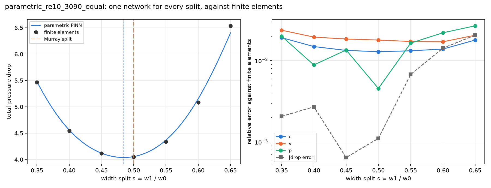

## Parametric Network 2: one network for every width split, against finite elements

Run `parametric_re10_3090_equal` (`bifurcation/p_re10_3090_equal.yaml`, seed 21). One physics-informed network takes (x, y, s), with s = w₁/w₀, over s ∈ [0.35, 0.65]. The layout is the fixed-geometry Network 2's: 30°/90°, parent 3 long, daughters 4 long, Re_h = 10, parabolic inflow, each daughter carrying half the flow. The stream-function construction makes no-slip, mass and the share exact at every split. The network has 5,487 parameters, including a degree-4 Chebyshev series for outlet 1's pressure offset λ(s).

Training: Adam for 3,000 steps, 4 L-BFGS cycles, then 150 Levenberg–Marquardt steps with fresh points every step. Each draw has 16 splits × 1,024 interior points. The network with the lowest held-out loss (32 splits × 1,024 points) was kept: LM step 62, held-out loss 0.0148. Training took 215 min on 4 CPU cores. A container restart at LM step 12 was resumed from the checkpoint, and the time it was stopped is not counted.

**Reproduced.** The trained weights were lost when the container was rebuilt, so the network was retrained from this config and seed (2026-10-08, bifurcation/runs/parametric_re10_3090_equal). The retrain reproduced every number below to the digits printed: the errors and drops at all seven splits, the optimum 0.4845 (drop 4.03852) against the finite-element 0.4848 (4.03583), and the regret +0.0004%. Its flow fields against finite elements are in docs/fields/pinn_speed.png and docs/fields/pinn_pressure.png (bifurcation/fields.py). The run's config, weights (params.npz), training history and metrics are now kept in git in that directory, so a rebuilt container no longer loses them; only the resumable checkpoint stays out.

### Fields and pressure drop at seven splits

The finite-element reference uses P2/P1 elements, maximum element area 0.002 and 6 corner refinements, with errors integrated on its own mesh. Both pressure drops are measured by the same 256-point line quadrature.

| split s | u, rel. L2 | v | p | drop: PINN | drop: FE | drop error | λ: PINN | λ: FE |
|---|---|---|---|---|---|---|---|---|
| 0.35 | 1.9e-2 | 2.4e-2 | 2.0e-2 | 5.4761 | 5.4648 | +0.21% | −6.547 | −6.595 |
| 0.40 | 1.5e-2 | 1.9e-2 | 8.8e-3 | 4.5601 | 4.5478 | +0.27% | −3.731 | −3.695 |
| 0.45 | 1.3e-2 | 1.8e-2 | 1.3e-2 | 4.1208 | 4.1182 | +0.06% | −1.523 | −1.469 |
| 0.50 | 1.3e-2 | 1.8e-2 | 4.6e-3 | 4.0561 | 4.0516 | +0.11% | +0.524 | +0.542 |
| 0.55 | 1.3e-2 | 1.7e-2 | 1.6e-2 | 4.3692 | 4.3399 | +0.68% | +2.784 | +2.694 |
| 0.60 | 1.4e-2 | 1.7e-2 | 2.2e-2 | 5.1536 | 5.0813 | +1.42% | +5.554 | +5.396 |
| 0.65 | 1.8e-2 | 2.0e-2 | 2.7e-2 | 6.4020 | 6.5361 | −2.05% | +9.057 | +9.307 |

Mass imbalance is at most 3.3 × 10⁻¹⁶ at every split, and the delivered share is 0.5 to 15 decimal places, by construction. Errors outside discs of radius 0.02 around the reflex corners are within 1% of the whole-domain values for u and v, and 0.1–6% lower for p, so the error is spread through the domain rather than concentrated at the corners.

The network is most accurate near the middle of its range, where the optimum lies, and least accurate at the edges, which are sampled from one side only. The drop error is 0.06–0.11% at s = 0.45–0.50 and 1.4–2.1% at s = 0.60–0.65.

### Against the fixed-geometry network, at s = 0.5 (the same problem)

| | parametric (all splits) | fixed geometry, run 3 |
|---|---|---|
| u, v, p rel. L2 | 1.29e-2, 1.79e-2, 4.5e-3 | 9.0e-3, 1.33e-2, 6.3e-3 |
| total-pressure drop error | **+0.11%** | +0.42% (run 2: −0.40%) |
| outlet 1's pressure offset | 0.524 (FE 0.542) | 0.556 |
| training | 215 min, for the whole range | 90 min, for this one geometry |

Covering the whole range cost about 40% in velocity error at s = 0.5. The pressure and the design objective came out more accurate, though one run cannot show whether that is systematic or within the run-to-run band of ±0.4% seen for the fixed network.

### The design question: where is the optimum?

The PINN's optimum is found by a 61-point scan of its drop curve followed by Brent's method, using line integrals only. The finite-element optimum is found by Brent's method around the best of the seven splits. Both use the same tolerance, 0.002 in s.

| | split s* | lowest drop |
|---|---|---|
| parametric PINN | **0.4845** | 4.0385 |
| finite elements | **0.4848** | 4.0358 |
| Murray split | 0.5000 | |

- **Argmin error:** −0.0003, inside the search tolerance of ±0.002. The network and the reference agree to within the precision of the search.
- **Regret** (the extra pressure drop of building the network's split, both evaluated by finite elements): +0.0004%. Since each optimum is located only to ±0.002 and J″/J ≈ 44 (Appendix A.3), the regret is better stated as below about 0.01%.
- **Error in the minimum drop:** +0.07%.

The location agrees because the drop error is nearly flat between s = 0.45 and 0.50 (0.06% to 0.11%). The optimum's position depends on that slope, not on the error's size (Appendix A.3, hypothesis H3). The much larger errors at the edges of the range do not move it.

The optimum lies 0.015 below the Murray split, so the more-turned daughter 2 is wider. That is twice the departure found in the design study for the same angles with daughters twice as long (0.4925 at L_d = 8). With shorter daughters the junction is a larger share of the total loss, which is the direction the junction-loss model of Appendix A.5 predicts.

### Cost

| route | cost of this design question (one layout, one share) |
|---|---|
| finite elements | 14 solves × 49 s = 11.4 min (7 evaluation splits, then 7 Brent steps) |
| parametric PINN | 215 min of training; then seconds per query |

For a single layout and share, finite elements are about 19 times cheaper. The parametric network answers only the question it was trained on. It would repay its training only if it replaced about 19 such optimisations, which requires the angles and the share to become inputs as well. For that wider question, Network 3 already answers in milliseconds, trained on the 165 finite-element optima of the design study (about one hour of solves). What this run does establish is that a physics-informed network, trained with no flow data at all, located the optimum to within the search tolerance with a regret below 0.01%.

### Training history

| phase | held-out loss (best) | cumulative time |
|---|---|---|
| Adam, 3,000 steps | 0.101 | 43 min |
| L-BFGS, 4 cycles | 0.040 (cycle 3) | 74 min |
| Levenberg–Marquardt, 150 steps | **0.0148** (step 62) | 215 min |

During the L-BFGS cycles the held-out loss stopped improving while the training loss kept falling: 2.1 times training after cycle 1, 4.3 times after cycle 4, when held-out rose from 0.040 to 0.043. Each cycle optimises one fixed draw, which favours fitting those points. Levenberg–Marquardt with fresh points at every step closed the gap.

Known issue, left as written: the slow test `test_training_reduces_the_held_out_loss` (`tests/test_parametric.py`) requires a tiny training run to halve the held-out loss, and it reaches 0.70. The fixed-geometry network at the same settings gives 0.40 or 0.61 depending on the seed, so halving at that budget depends on the seed rather than on correct code. The threshold has not been changed.

