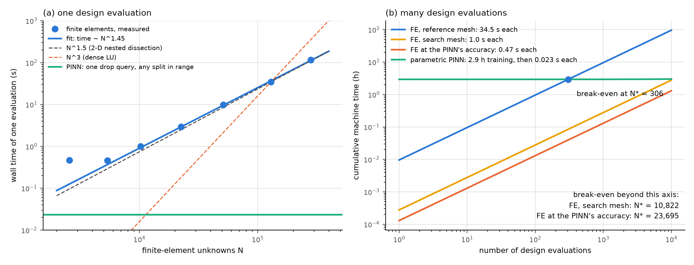
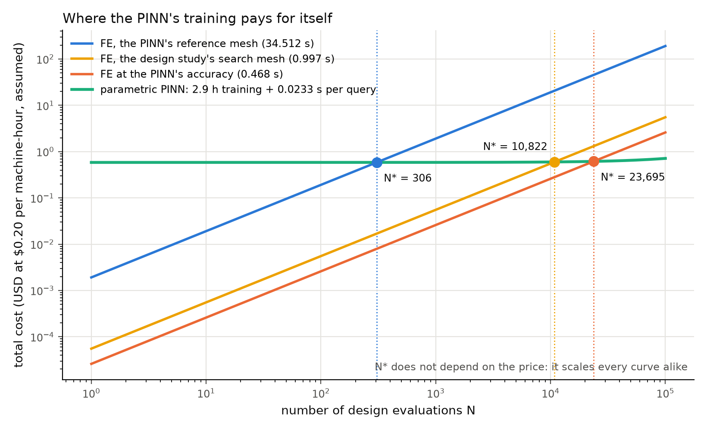

# Advanced benchmarking, diagnostics and figures: the parametric PINN

Draft sections for the manuscript. Every number is measured in this repository and
traceable to a file named beside it; where a quantity is an assumption (a price) it
is labelled as one. The layout throughout is the parametric network's: daughters at
30° and 90°, parent length 3, daughter length 4, Re_h = 10, half the flow through
each daughter, width split s = w₁/w₀ ∈ [0.35, 0.65].

Two networks are compared. **Original**: ψ = G + D²N (`bifurcation/runs/parametric_re10_3090_equal`).
**Corner modes**: the same network, seed, collocation points and schedule, with the
Stokes corner modes of Appendix A.8 added at the three reflex corners
(`bifurcation/runs/parametric_re10_3090_equal_corners`).

---

## A. Computational cost and economic value

### A.1 Cost model

Let a design evaluation be one value of the objective J(s), the drop in
flux-weighted total pressure (Section 3.3), at one split. A finite-element (FE)
evaluation on a mesh with N unknowns costs a wall time t_FE(N), which includes
meshing, assembly and the Newton iterations (four from the Stokes start at
Re_h = 10). A PINN evaluation costs a query time t_q, after an offline training
time T. For n evaluations,

$$
C_{\mathrm{FE}}(n) = n\,t_{\mathrm{FE}}(N), \qquad
C_{\mathrm{PINN}}(n) = T + n\,t_q ,
$$

and the PINN is cheaper beyond the break-even count

$$
n^{*} = \frac{T}{t_{\mathrm{FE}}(N) - t_q}, \qquad t_{\mathrm{FE}}(N) > t_q .
$$

All times were measured on one 4-core machine, one job at a time
(`python -m bifurcation.cost --config bifurcation/cost_re10.yaml`,
`docs/bifurcation_re10-cost.json`), so a measured second is a machine-second.
At a price π per machine-hour, a cost in dollars is C/3600 · π. Because π
multiplies both C_FE and C_PINN, **n\* does not depend on the price**; π only sets
the scale of Figure B.

Two conventions favour the PINN and are stated so they can be undone. Training
used all four cores, while each FE solve ran as a single process: design
evaluations are independent, so four FE solves can run at once on the same
machine, which would divide C_FE by up to four and multiply every n\* by up to
four. And T counts training only, not the FE solves that verified it.

The comparison is meaningful only at equal accuracy (Section 2.5). Table A1b sets
the coarsest FE mesh against both PINNs at the centre and both edges of the PINN's
range. The coarsest mesh's drop error is 0.066–0.089% at all three splits; the
corner-mode PINN's is 0.076% at s = 0.5 and 0.58% and 1.15% at the edges, the
original's 0.11–2.05%. So **every FE mesh in Table A1 is at least as accurate as
either PINN across the range**, and the coarsest is the fair baseline. The margin
is small at s = 0.5 (0.066% against 0.076%); at the edges the coarsest mesh is 6.5
and 15 times more accurate than the corner-mode PINN.

### A.2 Measurements

**Table A1. Finite elements on a ladder of meshes** (s = 0.5; Taylor–Hood P2/P1;
finite-element errors are measured against the finest mesh, PINN errors (Tables
A1b and A3) against the reference mesh 0.002/6; peak memory includes the ≈ 220 MB
interpreter and libraries).

| max element area | corner levels | triangles | unknowns N | solve (s) | peak memory (MB) | J | drop error |
|---|---|---|---|---|---|---|---|
| 0.08 | 2 | 520 | 2,569 | 0.468 | 236 | 4.048909 | −0.066% |
| 0.04 | 3 | 1,127 | 5,383 | 0.458 | 252 | 4.049837 | −0.044% |
| 0.02 | 3 | 2,176 | 10,236 | 0.997 | 284 | 4.050593 | −0.025% |
| 0.01 | 4 | 4,844 | 22,517 | 2.912 | 368 | 4.051389 | −0.0052% |
| 0.005 | 5 | 11,181 | 51,326 | 9.833 | 599 | 4.051519 | −0.0020% |
| 0.002 | 6 | 28,399 | 129,562 | 34.51 | 1,414 | 4.051576 | −0.0006% |
| 0.001 | 7 | 61,770 | 280,609 | 115.37 | 2,935 | 4.051601 | — |

The 0.02/3 mesh is the design study's search mesh; 0.005/5 its check mesh;
0.002/6 the reference against which both PINNs are scored.

**Table A1b. The equal-accuracy baseline across the range.** Drop error in J at the
centre and both edges of the PINN's range. Finite-element errors are measured
against the finest mesh (0.001/7); PINN errors against the reference mesh
(0.002/6), on which the PINNs were scored. The last column shows that the two
yardsticks differ by at most 0.0006% (`python -m bifurcation.cost_checks --config
bifurcation/cost_checks_re10.yaml`, `docs/bifurcation_re10-cost-checks.md`).

| split | coarsest FE mesh (0.08/2) | PINN, original | PINN, corner modes | reference mesh against finest |
|---|---|---|---|---|
| 0.35 | −0.089% | +0.21% | −0.58% | −0.0002% |
| 0.50 | −0.066% | +0.11% | −0.076% | −0.0006% |
| 0.65 | −0.078% | −2.05% | −1.15% | −0.0003% |

**Table A2. The parametric PINNs** (query times are medians of 20 after one
warm-up call; the warm-up pays for JIT compilation).

| | original | corner modes |
|---|---|---|
| parameters | 5,487 | 5,507 |
| training time T (Adam 3,000 + L-BFGS 4×500 + LM 150) | 9,778 s (163 min) | 10,537 s (176 min) |
| one drop query J(s): three 256-point line integrals | 0.0235 s | 0.0233 s |
| first query, including JIT compilation | 1.49 s | 1.85 s |
| full field at the reference mesh's 340,788 Gauss points | 0.89 s | 0.97 s |
| one Levenberg–Marquardt step (normal equations on 17,920 rows, and their solve) | 36.2 s | 37.6 s |
| peak memory, queries only | — | 447 MB (217 MB of it libraries) |
| peak memory, one LM step | 2.98 GB (2.6 GB when repeated, Table A5) | 3.89 GB |

**Table A3. Accuracy of the two PINNs against the reference mesh** (relative L2
errors integrated on the reference's own mesh; drop error in J).

| split | u, original | u, corner modes | v, original | v, corner modes | p, original | p, corner modes | drop error, original | drop error, corner modes |
|---|---|---|---|---|---|---|---|---|
| 0.35 | 1.91e-2 | 2.73e-3 | 2.36e-2 | 3.34e-3 | 1.99e-2 | 1.17e-2 | +0.21% | −0.58% |
| 0.40 | 1.49e-2 | 1.48e-3 | 1.95e-2 | 2.16e-3 | 8.84e-3 | 5.56e-3 | +0.27% | +0.30% |
| 0.45 | 1.33e-2 | 1.46e-3 | 1.84e-2 | 1.58e-3 | 1.35e-2 | 3.48e-3 | +0.06% | +0.18% |
| 0.50 | 1.29e-2 | 1.59e-3 | 1.79e-2 | 1.43e-3 | 4.55e-3 | 3.85e-3 | +0.11% | −0.08% |
| 0.55 | 1.32e-2 | 1.90e-3 | 1.72e-2 | 1.74e-3 | 1.64e-2 | 2.04e-3 | +0.68% | −0.08% |
| 0.60 | 1.39e-2 | 2.13e-3 | 1.70e-2 | 1.99e-3 | 2.20e-2 | 4.69e-3 | +1.42% | +0.34% |
| 0.65 | 1.79e-2 | 4.01e-3 | 2.05e-2 | 3.90e-3 | 2.68e-2 | 1.21e-2 | −2.05% | −1.15% |

The corner modes cut the velocity errors by a factor of 5–9 at every split and the
worst drop error from 2.05% to 1.15%. The drop error near the optimum is not
smaller (0.18% against 0.06% at s = 0.45): the objective's error at a given split
is dominated by the pressure level at the openings (Section B.3), which the field
norms weight weakly.

**Table A4. Cost of n design evaluations.** Machine-hours, and dollars at an
**assumed** π = \$0.20 per machine-hour (substitute your own rate; the n\* column
is independent of it).

| route | per evaluation | offline | n = 100 | n = 1,000 | n = 10,000 | break-even n\* | memory |
|---|---|---|---|---|---|---|---|
| FE, reference mesh (0.002/6) | 34.5 s | — | 0.96 h (\$0.19) | 9.59 h (\$1.92) | 95.9 h (\$19.17) | 306 | 1.4 GB |
| FE, search mesh (0.02/3) | 0.997 s | — | 0.028 h (\$0.006) | 0.28 h (\$0.055) | 2.77 h (\$0.55) | 10,822 | 284 MB |
| FE, at the PINN's accuracy (0.08/2) | 0.468 s | — | 0.013 h (\$0.003) | 0.13 h (\$0.026) | 1.30 h (\$0.26) | 23,695 | 236 MB |
| PINN, corner modes | 0.0233 s | 2.93 h | 2.93 h (\$0.59) | 2.93 h (\$0.59) | 2.99 h (\$0.60) | — | 0.45 GB query, 3.9 GB training |

At equal accuracy the PINN pays for its training after about 2.4 × 10⁴ design
evaluations, or about 9.5 × 10⁴ if the finite-element solves use all four cores;
it is cheaper than the much more accurate reference mesh beyond 306. One
optimisation of the split, as done here (7 evaluation splits and 7 Brent steps
with finite elements; a 61-point scan and Brent with the PINN), uses 14 to 25
evaluations: the PINN does not repay its training within one design question,
nor within a hundred.

### A.3 Scaling

**Finite elements.** For two-dimensional problems a sparse direct solver with
nested-dissection ordering factorises in O(N^{3/2}) operations and O(N log N)
memory (George 1973 ⚠). The measured solve time over the meshes with at least
20,000 unknowns grows like N^{1.45} (Figure A(a)), and memory roughly linearly
(368 MB at 22,517 unknowns, 2.9 GB at 280,609, consistent with N log N). The cubic
O(N³) scaling sometimes quoted for FE is that of dense Gaussian elimination, which
no FE code uses for a problem of this kind: anchored at the reference mesh, N³
would put the finest mesh at 351 s against the measured 115 s, and the coarsest at
0.27 ms against the measured 0.47 s. Below
about 10⁴ unknowns the time is set by fixed costs (meshing, Python-level
assembly), which is why the two coarsest meshes cost the same 0.46 s.

A sweep of n designs costs n · t_FE(N): linear in n, with no offline cost and
perfect parallelism across designs.

**PINN queries.** A query evaluates the network at M points; each evaluation
costs O(P) multiply-adds for P parameters, so a query is O(P M), independent of
any mesh. The drop query (M = 768) took 0.023 s, the whole field at 340,788
points 0.97 s: 2.8 µs per point after compilation, against 30 µs per point for the
768-point query, whose cost is dominated by fixed overhead.

**PINN training.** One Levenberg–Marquardt step forms JᵀJ from B residual rows,
O(B P²), and solves a P × P system, O(P³). Measured at three widths (Table A5),
the step time grows like P^{1.9} from 5,487 to 10,367 parameters and like
P^{2.4} from 10,367 to 16,783, as the cubic solve takes over, and memory like
P² (the matrix JᵀJ alone is 8P² bytes: 2.25 GB at P = 16,783).

**Table A5. One Levenberg–Marquardt step against the network's width**
(17,920 rows). Width 40 is the original network's step of Table A2, measured again
in a separate process: 2.6 GB here against 2.98 GB there. A process's peak memory
varies by that much, about 15%, from one measurement to the next, so the memory
figures in Tables A2, A4 and A5 are good to about 15%; the corner-mode network's
3.89 GB is a single measurement.

| width | parameters P | step (s) | peak memory |
|---|---|---|---|
| 40 | 5,487 | 36.2 | 2.6 GB |
| 56 | 10,367 | 122.4 | 4.2 GB |
| 72 | 16,783 | 382.1 | 8.4 GB |

### A.4 Figures A and B

`docs/figures/fig_a_time_scaling.py` and `docs/figures/fig_b_break_even.py` are
standalone (numpy and matplotlib only) and carry the measured numbers; run
either with `python docs/figures/<name>.py`. Seaborn is not required.



**Figure A. Simulation time.** (a) One FE solve against its number of unknowns:
measured (points), the fitted N^{1.45} (line), and the nested-dissection N^{1.5}
and dense-LU N³ rates anchored at the reference mesh (dashed); the horizontal
line is one PINN drop query at any split in its range. (b) Cumulative machine
time for 1 to 10⁴ design evaluations; the marked point is the break-even with
the reference mesh, and the other two baselines break even beyond this axis.



**Figure B. Amortisation.** Total cost against the number of design evaluations
at an assumed π = \$0.20 per machine-hour, with each FE baseline's break-even
n\* marked. Changing π moves every curve by the same factor and leaves n\*
unchanged.

---

## C. Fluid mechanics: dissipation, wetted perimeter and Murray's law

### C.1 Why splitting a channel raises its resistance

For steady, fully developed flow in a planar channel of width w carrying flux Q
per unit depth (non-dimensional, density 1, kinematic viscosity ν = 1/Re_h),

$$
u(\eta) = \frac{6Q}{w^3}\left(\frac{w^2}{4} - \eta^2\right), \qquad
\Delta p = \frac{12\,\nu L Q}{w^3}, \qquad
\tau_w = \frac{6\,\nu Q}{w^2}, \qquad
R = \frac{\Delta p}{Q} = \frac{12\,\nu L}{w^3}.
$$

A force balance on the fluid between two cross-sections a length L apart gives
Δp · w = 2 τ_w L: the pressure force is carried by shear on the two walls. The
mechanical energy balance (Appendix A.6) gives the dissipation as the work of
the pressure drop, Φ = Q Δp, so per unit length

$$
\frac{\Phi}{L} = \frac{Q\,\Delta p}{L} = \frac{2\,\tau_w}{w}\,Q = P_w\,\tau_w\,U ,
\qquad P_w = 2, \quad U = \frac{Q}{w}.
$$

Here P_w is the wetted perimeter per unit depth and length (two walls in a
planar channel): the dissipation is the rate of work done against wall shear,
the wall area times the shear stress times the mean speed. In thermodynamic
terms, at a uniform temperature T₀ the viscous heating produces entropy at the
rate Ṡ = Φ/T₀ = ∫ 2ν e:e dA / T₀ ≥ 0, and at a fixed flux every extra unit of
resistance is extra entropy produced.

Now split a parent of width w₀ into two daughters of the same length L with
w₁ + w₂ = w₀ (the planar design constraint of this study) and equal outlet
pressures, so they act as parallel resistances:

$$
\frac{1}{R_\parallel} = \frac{w_1^3 + w_2^3}{12\,\nu L}, \qquad
\frac{R_\parallel}{R_0} = \frac{1}{s^3 + (1-s)^3} = \frac{1}{1 - 3s(1-s)} \ \ge\ 1 ,
$$

with R₀ = 12νL/w₀³ the undivided channel's resistance; equality holds only as
s → 0 or 1, and the ratio is 4 at s = 1/2. The septum adds two walls of length L,
doubling P_w from 2 to 4, while the cross-section stays w₀. For n equal daughters
of width w₀/n,

$$
R_\parallel = n^2 R_0 = \left(\frac{P_w}{2}\right)^{2} R_0 ,
$$

so at a fixed footprint the resistance grows as the square of the wetted
perimeter: the same flux is driven past more wall, through narrower passages
whose shear (τ_w ∝ Q/w²) is higher. This is a statement about a fixed total
width. Murray's three-dimensional law keeps volume, not cross-section, and its
daughters' total cross-section exceeds the parent's (r₁³ + r₂³ = r₀³ gives an
area ratio of 2^{1/3} ≈ 1.26 at a symmetric split), so it does not imply a rise in
resistance. At the junction itself the developing flow and the corners add
losses beyond friction, modelled in Section 4.7 as Kᵢ ½Uᵢ².

### C.2 Minimum dissipation at fixed flux is maximum flux at fixed pressure drop

Let J(s, Q) be the drop in total pressure at split s and inflow Q, with the share
q held fixed, and suppose ∂J/∂Q > 0 (more flow needs more pressure: exact in Stokes
flow, where J = R(s) Q with R > 0, and assumed here for the laminar range studied). The design problem of this paper is

$$
s^{*} = \arg\min_{s}\, J(s, Q_0) \qquad \text{(fixed flux)} .
$$

Fix instead the pressure drop, J(s, Q) = ΔP, and let Q(s) be the flux that
results. Differentiating the constraint,

$$
J_s + J_Q\,Q'(s) = 0 \ \Rightarrow\ Q'(s) = -\frac{J_s}{J_Q}, \qquad
Q''(s)\big|_{Q'=0} = -\frac{J_{ss}}{J_Q} .
$$

Q is stationary exactly where J_s = 0, and since J_Q > 0, a minimum of J in s
(J_ss > 0) is a maximum of Q. So **the split that minimises the pressure drop at a
fixed flux is the split that maximises the flux at a fixed pressure drop**, at the
operating point where the two problems meet, Q(s\*) = Q₀ when ΔP = J(s\*, Q₀). In
Stokes flow J = R(s)Q, the argmin does not depend on Q, and the equivalence holds
at every pressure drop; it is then Helmholtz's minimum-dissipation theorem (the
Stokes solution dissipates least among divergence-free fields with the same
boundary data), since Q₀J = Φ + B with the boundary term B vanishing for
developed outflow (Appendix A.6). At finite Reynolds number s\* depends on Q
through Re_h. The closed-length maps at Re_h = 10, 25, 50 and 100 measure that
dependence (`docs/bifurcation_closed-junction.md`): with both daughters' walls
8 long, s_M is the friction optimum, and the largest |s\* − s_M| below 180° grows
from 0.0082 at Re_h = 10 (30/120) to 0.013 at Re_h = 100 (0/120, 30/120 and 0/150).
[Author note: these maps are in no version of the paper yet. Add them as a section
and cite it here, or cut this sentence.]

To first order the flux gained at a fixed pressure drop equals the drop saved at
a fixed flux: Q ∝ 1/R gives δQ/Q = −δR/R. For this layout the finite-element
optimum is s\* = 0.4848 with J\* = 4.0358, and the Murray split s_M = 0.5 gives
J = 4.0516, so building s\* instead of s_M saves 0.39% of the pressure drop at the
design flux, or carries 0.39% more flow at the design pressure drop. The PINNs
place the optimum at 0.4845 (original) and 0.4862 (corner modes), both within the
search tolerance of 0.002, at a cost against the true optimum of 0.0004% and
0.0035%. For this layout J″/J = 33.6 at the optimum, measured by central
differences on the reference mesh (`docs/bifurcation_re10-cost-checks.md`); the
J″/J ≈ 44 of Appendix A.3 is for the design study's daughters of length 8. A split
error δ costs ½ · 33.6 · δ²: the corner-mode network's δ = 0.00143 predicts 0.0034%,
against the measured 0.0035%.

---

## B. Diagnostics of the lagging components

The measurements below come from `python -m bifurcation.diagnose --config
bifurcation/diagnose_re10.yaml` (`docs/bifurcation_re10-diagnostic.{md,json,png}`):
both trained networks against the reference solution at s = 0.35, 0.5 and 0.65,
every integral taken on the reference's own mesh.

### B.1 Where the error lives

Partition the domain into annuli by the distance r to the nearest singular corner
(B, C or the septum tip T). In annulus k let

$$
\varepsilon_k = \left(\frac{\int_{A_k} |\mathbf{u}_{\mathrm{PINN}}-\mathbf{u}_{\mathrm{FE}}|^2\,dA}
{\int_{A_k} |\mathbf{u}_{\mathrm{FE}}|^2\,dA}\right)^{1/2}, \qquad
\sigma_k = \frac{\int_{A_k} |\mathbf{u}_{\mathrm{PINN}}-\mathbf{u}_{\mathrm{FE}}|^2\,dA}
{\int_{\Omega} |\mathbf{u}_{\mathrm{PINN}}-\mathbf{u}_{\mathrm{FE}}|^2\,dA},
$$

the local relative error and the annulus's share of the squared error.

**Table B1. Velocity error by distance to the nearest corner, s = 0.5.**

| r | share of area | original: share σ | original: local ε | corner modes: share σ | corner modes: local ε |
|---|---|---|---|---|---|
| 0–0.02 | 0.02% | 0.9% | 0.66 | 0.0% | 1.5e-2 |
| 0.02–0.05 | 0.09% | 4.5% | 0.36 | 0.2% | 7.7e-3 |
| 0.05–0.1 | 0.31% | 9.0% | 0.18 | 0.3% | 3.2e-3 |
| 0.1–0.2 | 1.22% | 14.9% | 8.2e-2 | 0.5% | 1.5e-3 |
| 0.2–0.5 | 8.55% | 25.8% | 2.9e-2 | 7.9% | 1.7e-3 |
| 0.5–1 | 23.16% | 42.2% | 2.0e-2 | 15.8% | 1.3e-3 |
| > 1 | 66.66% | 2.7% | 2.9e-3 | 75.3% | 1.6e-3 |

In the original network the error is a corner error that pollutes its
surroundings: the local error falls from 0.66 within 0.02 of a corner to 0.003
beyond a distance of 1, and the 1.6% of the area within 0.2 of a corner holds 29%
of the squared error; 97% of it lies within 1 of a corner. The corner modes remove
that structure. Within 0.2 of a corner the local error falls 40–60-fold (0.66 to
0.015, 0.18 to 0.003), beyond a distance of 1 only 1.8-fold (2.9 to 1.6 × 10⁻³);
the profile becomes flat (1.3–1.7 × 10⁻³ from r = 0.1 outward), and 75% of what
remains lies more than 1 from any corner. What is left is the
network's approximation error in the bulk of the flow, no longer a singularity.

At the edge of the range the picture is different. At s = 0.65 the corner-mode
network's local error is 8.5 × 10⁻³ in the annulus 0.2 < r < 0.5 and 5.3 × 10⁻³ in
0.5 < r < 1, five and four times its values at s = 0.5, and 81% of its squared
error lies within 1 of a corner (`docs/bifurcation_re10-diagnostic.md`). The edge error is
corner-adjacent, not uniform.

### B.2 Does the loss locate the error?

At a seeded subsample of 20,000 of the same points, the unweighted momentum
residual |R| was compared with the local velocity error by Spearman's rank
correlation ρ:

| split | original ρ | corner modes ρ |
|---|---|---|
| 0.35 | 0.75 | 0.44 |
| 0.5 | 0.81 | 0.17 |
| 0.65 | 0.71 | 0.43 |

In the original network the residual is a good map of the error, because both are
set by the same singularity. Once the corner modes remove it, the residual no
longer says where the error is (ρ = 0.17 at s = 0.5): the remaining error is a
smooth, global field (pressure level, slight mass redistribution between regions)
that a pointwise residual measures only weakly. This is the strongest form yet of
the rule that the loss is a diagnostic, never an accuracy claim: the better the
network, the less its own residual tells you about its error.

### B.3 Why the drop error spikes at the edges of the range

The objective is

$$
J = \frac{E_{\mathrm{in}} - E_1 - E_2}{Q_0}, \qquad
E_k = \int_{\Gamma_k}\Bigl(p + \tfrac12|\mathbf{u}|^2\Bigr)\,\mathbf{u}\cdot\mathbf{n}\,ds ,
$$

and since the stream function makes every flux exact, its error separates into
each opening's pressure and kinetic parts to first order:

**Table B2. Error in J by opening** (each term divided by Q₀; they sum to
J_PINN − J_FE).

| split | run | inlet pressure | inlet kinetic | outlet 1 pressure | outlet 1 kinetic | outlet 2 pressure | outlet 2 kinetic | J error |
|---|---|---|---|---|---|---|---|---|
| 0.35 | original | +0.0519 | +0.0020 | −0.0391 | −0.0033 | −0.0008 | +0.0006 | +0.21% |
| 0.35 | corner modes | −0.0316 | +0.0001 | −0.0039 | −0.0002 | +0.0042 | −0.0001 | −0.58% |
| 0.5 | original | −0.0019 | −0.0004 | +0.0069 | −0.0004 | −0.0002 | +0.0005 | +0.11% |
| 0.5 | corner modes | −0.0142 | −0.0001 | +0.0079 | −0.0005 | +0.0041 | −0.0003 | −0.08% |
| 0.65 | original | −0.2710 | +0.0009 | +0.1350 | +0.0009 | +0.0017 | −0.0015 | −2.05% |
| 0.65 | corner modes | −0.1360 | +0.0003 | +0.0629 | −0.0003 | −0.0015 | −0.0005 | −1.15% |

Three conclusions follow.

1. **The objective's error is a pressure-level error.** The kinetic terms are
   10–1,000 times smaller than the pressure terms. Because the stream function
   fixes every flux exactly, an error in J is an error in the mean static pressure
   at the openings: δJ ≈ δp̄_in − q δp̄₁ − (1 − q) δp̄₂.
2. **Inlet and outlet 1 compensate.** The inlet pressure error and outlet 1's
   (set by the trained offset λ(s)) have opposite signs at every split and partly
   cancel. At s = 0.65 the corner-mode network's inlet pressure is 0.136 too low
   and outlet 1's term +0.063: the net −0.075 is the −1.15%. The field norm of p
   (1.2 × 10⁻² there) and the drop error are therefore only loosely related, which
   is why the corner modes improved every field error 5–9-fold but the drop error
   near the optimum not at all.
3. **The edges are where the momentum residual is largest.** On the held-out
   design nearest each split, the corner-mode network's interior loss is
   2.39 × 10⁻³ at s = 0.352, 5.91 × 10⁻⁴ at 0.503 and 2.64 × 10⁻³ at 0.645: four times
   larger at both edges. Two causes act together. Geometrically, at s = 0.65 the
   90° daughter is narrowest (w₂ = 0.70) while carrying half the flow, so its mean
   speed (0.95) is 43% above the symmetric case, the turn at B is fastest, and B
   is closest to the opposite wall (0.70, the margin the corner cutoff was checked
   against); s = 0.35 does the same to the 30° daughter and the septum tip. Statistically,
   the stratified design sampling puts one design in each of 16 bins of width
   0.019, so the network sees the edge splits from one side only: s = 0.65 is an
   extrapolation boundary of its training distribution. The pressure level is an
   integral of the momentum balance along the flow path from the outlets to the
   inlet, so a fourfold residual near the junction becomes a pressure-level error
   at the inlet, and the drop error follows.

The remedy that follows is to train on a range wider than the one in which
answers are needed (for example [0.33, 0.67] to report on [0.35, 0.65]), so that
no reported split lies on the sampling boundary, and to draw designs in proportion
to their held-out interior loss (B.5).

### B.4 Gradient pathology analysis

Wang, Teng and Perdikaris (2021) show that a PINN trained by gradient descent on a
composite loss L = Σ_k λ_k L_k becomes stiff when the terms' parameter gradients
differ by orders of magnitude: the optimiser follows the dominant term and the
others stall. The diagnostic is the ratio

$$
\rho_{\mathrm{grad}} = \frac{\lVert \nabla_\theta \mathcal{L}_{\mathrm{pde}} \rVert_2}
{\lVert \nabla_\theta \mathcal{L}_{\mathrm{bc}} \rVert_2},
\qquad \mathcal{L}_{\mathrm{bc}} = \mathcal{L}_{\mathrm{inlet}} + \mathcal{L}_{\mathrm{outlet\,1}} + \mathcal{L}_{\mathrm{outlet\,2}},
$$

tracked through training. Here no-slip, mass conservation and the flow share are
exact by construction, so the only boundary terms are the inlet profile and the two
outlet tractions.

**Table B3. Loss terms and their gradients at the trained parameters** (held-out
design nearest each split).

| run | split | interior loss | inlet loss | outlet 1 loss | outlet 2 loss | ρ_grad |
|---|---|---|---|---|---|---|
| original | 0.352 | 1.17e-1 | 1.6e-5 | 6.6e-4 | 1.4e-5 | 6.47 |
| original | 0.503 | 1.16e-2 | 5.6e-6 | 2.1e-5 | 2.2e-6 | 3.86 |
| original | 0.645 | 2.49e-2 | 1.3e-5 | 2.0e-4 | 1.7e-5 | 2.97 |
| corner modes | 0.352 | 2.39e-3 | 4.6e-6 | 1.4e-5 | 6.2e-5 | 1.26 |
| corner modes | 0.503 | 5.91e-4 | 4.3e-6 | 1.4e-6 | 6.2e-5 | 0.44 |
| corner modes | 0.645 | 2.64e-3 | 2.1e-6 | 5.9e-6 | 8.7e-6 | 3.94 |

At the trained parameters the gradients are balanced within an order of
magnitude (ρ_grad between 0.44 and 6.5), far from the ratios of 10²–10³ that mark
the pathology. Two features of this training explain it. The final stage is
Levenberg–Marquardt, a Gauss–Newton method whose step (JᵀJ + μD)δ = −Jᵀr rescales
every direction by the curvature, so a term with small gradients is not starved
the way it is under a fixed learning rate. And the hard constraints remove the
terms (no-slip, continuity) that are usually the stiff ones. The ratio is largest
at the edges (3.94 at 0.645 against 0.44 at 0.503 for the corner modes), where the
interior residual is fourfold: the boundary terms are not under-weighted there, the
momentum balance is simply harder.

To track ρ_grad through a run, compute it at every checkpoint from the same draw:

```python
from jax.flatten_util import ravel_pytree
import jax, jax.numpy as jnp, numpy as np

def term_gradient_norms(groups, params, batch):
    """{term: ||grad_theta L_term||} for flow.optimise's point groups."""
    names = ("interior", "inlet", "outlet1", "outlet2")
    norms = {}
    for name, (fn, rows) in zip(names, groups(batch)):
        rows = jnp.asarray(rows)
        n = rows.shape[0]
        loss = lambda p: jnp.sum(jax.vmap(lambda r: fn(p, r, n))(rows) ** 2)
        norms[name] = float(np.linalg.norm(np.asarray(ravel_pytree(jax.grad(loss)(params))[0])))
    return norms
```

and log it beside the losses in `flow.optimise`'s `record`. The same function, at
the trained parameters, produced Table B3 (`bifurcation/diagnose.py`,
`term_gradients`).

### B.5 Residual-based adaptive refinement (RAR)

RAR, introduced with the DeepXDE library (Lu et al. 2021a), adds collocation points
where the residual is large. The
density-based form (RAR-D; Wu et al. 2023 ⚠) draws, at each resampling, a pool
X_pool of M uniform points and keeps n of them with probability

$$
p(\mathbf{x}) \propto \frac{|R(\mathbf{x})|^{k}}{\mathbb{E}\bigl[|R|^{k}\bigr]} + c ,
$$

with k ≥ 1 sharpening the focus and c > 0 keeping every region sampled. For the
parametric network the points are (x, y, s), so the algorithm runs over the
geometry and the design range together:

1. Draw D designs s_j by stratified sampling over the range, and for each a pool
   of M interior points uniform in its polygon, outside the corner-exclusion disc.
2. Evaluate the unweighted momentum residual |R| at every pool point (one batched
   forward-mode pass, as for the loss).
3. For each design keep n points with probability p ∝ |R|^k / mean(|R|^k) + c,
   without replacement, together with a uniform draw of the same size, so that
   at least half of every draw stays unbiased.
4. Weight each adaptive point by the inverse of its sampling density in the loss,
   so the loss remains an unbiased estimate of the residual integral rather than of
   a residual-weighted one.
5. Resample at every Levenberg–Marquardt step, as now; score the held-out points
   uniformly, never adaptively, so that the selection of the iterate is unbiased.

This project's Network 1 already implements RAR (`sampling.rar_points`,
`rar_mode` = top or proportional, `rar_exponent`, `rar_floor`;
`developing_flow/pinn.py`). On the developing channel it did not help: keeping the
1,024 worst of 32,768 pool points raised the held-out loss from 7.7 × 10⁻⁶ to
1.0 × 10⁻⁵ and the error of the developed profile at x\* = 4 from 8.8 × 10⁻⁵ to
3.4 × 10⁻⁴, while lowering it at x\* = 10 from 3.4 × 10⁻⁴ to 1.7 × 10⁻⁴
(`docs/developing_re10-baseline-vs-rar-tables.md`).

For the bifurcation two cautions follow from B.1 and B.2. Without the corner modes
the residual grows like 1/r at a reflex corner and is not square-integrable, so
spatial RAR would pile points into the singularity and the loss would be set by the
closest point (one early draw scored 1.4 × 10³ against a held-out 21); the corner
exclusion disc exists for that reason and must be kept. With the corner modes the
residual-error correlation is weak (ρ = 0.17 at s = 0.5), so spatial RAR would
chase residual hot spots that are not where the error is. The refinement that the
measurements do support is in the design coordinate: draw designs in proportion to
their held-out interior loss, which is four times larger at both edges of the
range (B.3).

### B.6 Domain decomposition against distance functions

Two families of construction handle complex geometry.

**Distance functions (used here).** The wall distance D is built from the
polygon's segments by R-functions (Sukumar & Srivastava 2022): each segment's
trimmed distance φ_i vanishes on that segment only, and
D = (Σ φ_i^{−m})^{−1/m}. With ψ = G + D²N, no-slip, mass conservation and the flow
share hold for every parameter value, and because the vertices are differentiable
functions of s, one network serves the whole design range. The construction
requires a fixed topology: the same polygon structure (vertex count, which edges
are walls, which corners are reflex) at every s. `parametric.structure` checks
this at 33 splits and refuses a range where it changes. The relevant change in
this problem is at α₁ + α₂ = 180°, where the septum tip becomes a face (9
vertices become 10); a range crossing it is refused (`tests/test_parametric.py`,
"septum-tip").

**Domain decomposition** (XPINN, Jagtap & Karniadakis 2020 ⚠; cPINN, Jagtap,
Kharazmi & Karniadakis 2020 ⚠) gives each sub-domain its own network, here the
parent, the junction and each daughter, coupled by interface losses on the
solution and its fluxes,

$$
\mathcal{L}_{\Gamma_{ij}} = \frac{1}{N_\Gamma}\sum \Bigl(\lVert \mathbf{u}_i - \mathbf{u}_j \rVert^2
+ \lVert (\boldsymbol{\sigma}_i - \boldsymbol{\sigma}_j)\mathbf{n} \rVert^2\Bigr) .
$$

Its advantages are local capacity (a larger network in the junction, where B.1
puts the error) and parallel training. Its costs are that continuity and mass
conservation across interfaces become soft penalties again, exactly the drift
that the stream-function construction was introduced to remove (Phase 1's 6% mass
gain; Network 2's first formulation lost 6.3% of the mass), and that the
interfaces themselves move with s.

**For a topological shift** between a tip septum and a face septum, neither
method is continuous. Three options exist: (i) one parametric network per
topology, with the design range split at α₁ + α₂ = 180°; (ii) a blended distance
function in which the face's length is itself a design parameter that reaches zero
at the tip, so that one construction covers both (the corner set then changes
continuously, and the corner modes' exponents with it); (iii) domain
decomposition with a junction sub-domain whose network takes the topology as an
input. Option (i) keeps every guarantee of the present construction and is the
recommended one; (ii) is the only one that keeps a single network, at the price of
a corner whose angle, and so whose singular exponent, varies along the design
path.

### B.7 The four accuracy options (running)

The four ways of improving the corner-mode network further are being tested as
equal-budget continuations from it (50 Levenberg–Marquardt steps on seed 22's
draws, ranked against finite elements): continue unchanged; ease the corner weight
from 0.3 to 0.1; add the next corner terms (Re z < 2: 1.4858 at C, 1.1489 and
1.8335 ± 0.2523i at T, 1.6293 ± 0.2313i at B); widen to 56 neurons per layer
(10,387 parameters, each LM step 3.4 times dearer, Table A5). Results will be
added from `docs/bifurcation_re10-options.md`.

---

## D. Figure inventory

Eight figures. Colours follow one rule across all of them, so an entity keeps its
colour from figure to figure: finite elements are ink (#0b0b0b) points, the
original PINN orange (#eb6834), the corner-mode PINN blue (#2a78d6), and the
three FE meshes of the cost figures blue, yellow (#eda100) and orange as in
Figures A–B. Sequential fields use `viridis`; signed fields, whose zero means
something, use `coolwarm` with symmetric limits; the cyclic `twilight` is reserved
for an angle, the flow direction, where 0 and 2π are the same value. Error
magnitudes spanning decades use `magma` on a logarithmic scale. One vertical axis
per panel throughout.

**Figure 1. Geometry and design variable.** Axes x*, y* (non-dimensional, equal
aspect). The polygon outlines at s = 0.35, 0.4848 (the optimum) and 0.65,
overlaid in three greys, with the inlet and outlets in orange. Callouts at the
reflex corners: C (210°, z = 0.752), where the 30° daughter leaves, B (270°,
z = 0.5445 and 0.9085), where the 90° daughter leaves, and the
septum tip T (240°, z = 0.6157), with the corner modes' cutoff circles
(radius 0.5) dashed. Source: the paper's existing Figure 1 plus
`bifurcation/corners.py` for the exponents.

**Figure 2. Reference flow at three splits.** Three columns, s = 0.35, 0.4848,
0.65, finite elements on the reference mesh (0.002, 6 levels). Row 1: speed |u|,
`viridis`, 16 equal levels from 0 to the largest speed of the three panels
(shared colour bar), with streamlines in white at 0.6 pt. Row 2: pressure
relative to outlet 2, `coolwarm` with limits ±max|p| over the three panels, so
that the sign of outlet 1's offset λ(s) (−6.59, +0.53, +9.31) is read off the
colour. Optional row 3: flow direction atan2(v, u), `twilight`, showing the
turn into each daughter and any reversal near B. Callouts: s, J and λ in each
column's title. Source: `bifurcation/fields.py fe` (sampled fields cached in
`runs/fields_re10`).

**Figure 3. Where each PINN is wrong.** Two rows (original, corner modes) by
three columns (s = 0.35, 0.5, 0.65). Pointwise velocity error |u_PINN − u_FE|,
`magma`, logarithmic from 10⁻⁵ to 10⁻¹ (one colour bar for all six panels), with
the singular corners marked by small white crosses and the training's excluded
discs (radius 0.02) outlined. A fourth column, or a separate panel, gives the
signed pressure error p_PINN − p_FE with `coolwarm` and symmetric limits.
Callout in each panel: its relative L2 errors from Table A3. Source:
`bifurcation/fields.py pinn` for both runs.

**Figure 4. Error against distance to the nearest corner.** x: distance r to
the nearest singular corner (log, 0.02 to 2); y: relative RMS velocity error in
each annulus (log). One line per run (orange, blue), one panel per split
(0.35, 0.5, 0.65), with the area share of each annulus as a grey bar strip
below. Callouts: the annuli holding most of the squared error. Source:
`python -m bifurcation.diagnose --config bifurcation/diagnose_re10.yaml`
(`docs/bifurcation_re10-diagnostic.png`).

**Figure 5. Training.** x: wall time (min); y: held-out loss (log). Both runs,
phases shaded in light grey bands (Adam, L-BFGS, Levenberg–Marquardt), each
run's selected iterate marked with an open circle and labelled with its loss
(1.48 × 10⁻² and 9.15 × 10⁻⁴). A second panel, same axes, adds the four
equal-budget continuations of Section B.7 once they finish. Loss is shown as
the diagnostic it is; the y-axis label says so. Source: each run's
`history.json`.

**Figure 6. The design objective and its optimum.** x: split s (0.35 to 0.65);
y: total-pressure drop J. Finite elements as ink points at the seven evaluation
splits; each PINN's 61-point curve as a line; vertical markers at the FE optimum
0.4848, the PINN optima 0.4845 and 0.4862 and the Murray split 0.5, labelled
directly. Inset or second panel: drop error (%) against s for both PINNs, zero
line in grey. Callouts: the regrets 0.0004% and 0.0035% and the 0.39% saved by
s\* over s_M. Source: `metrics.json` of both runs (`optimum.curve`, `splits`).

**Figure 7 (A). Simulation time scaling.** As specified in Section A.4;
`docs/figures/fig_a_time_scaling.py`.

**Figure 8 (B). Amortisation and break-even.** As specified in Section A.4;
`docs/figures/fig_b_break_even.py`.
