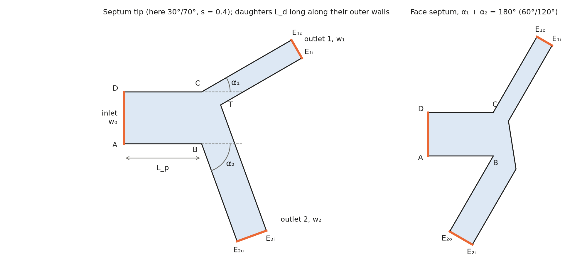
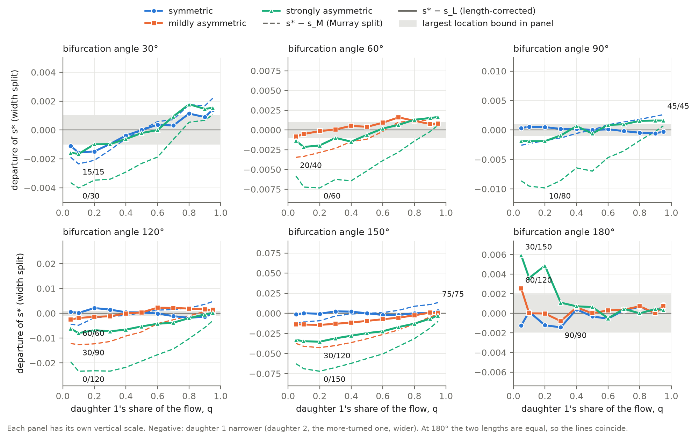

# Beyond Murray's Split: Optimal Widths of Planar Channel Bifurcations and Neural Networks in the Design Loop

Version 9, revised after review. Figure files are in this directory: fig1_geometry.png and fig2_departure_lengths.png.

## Abstract

Murray's law sizes the branches of a fluid network as if every channel were fully developed and every junction lossless. We map how the pressure-drop-optimal width split of a planar bifurcation departs from it with the junction flow resolved: 165 finite-element optima over fifteen layouts (bifurcation angles 30–180°, flow shares 5–95%, daughters sharing the parent's width, Reynolds number 10). Below 180°, the optimum departs from the planar Murray split by at most 0.010 up to 90° and by up to 0.072 at 150°. Most of this is a length effect: with each outer wall fixed, a turned daughter's centreline is longer, and Murray's relation applied with the real centreline lengths, with no fitted parameter, removes 78–96% of the squared departure in eleven of twelve layouts. The remaining junction and entrance effect is at most 0.003 unless a daughter turns back beyond 90°; there it reaches 0.013–0.035, depending on how length is counted, and always widens the turned daughter, but a junction-loss model does not locate it. Ignoring lengths and junction costs a median 0.016% in pressure drop, but up to 8.9% where a daughter turns back. Physics-informed networks cost 20–160 times the finite-element solves they replace, though one located the optimum within the search tolerance. A network trained on the optima has 0.016% mean regret on held-out layouts, against 0.109% for the Murray split, but the free length-corrected split matches it (0.015%), and one solve there gives the optimal drop to 0.02%, against the network's 0.48%.

**Keywords:** Murray's law; bifurcation; junction losses; physics-informed neural networks; shape optimisation; finite elements

## 1. Introduction

Branching channels distribute fluid in organisms and in devices, from the vascular system to the manifolds of a lab-on-a-chip (Emerson et al., 2006; Murray, 1926b). Murray's rule sizes them by minimising the combined cost of pumping and of the volume a vessel holds (Murray, 1926b). For planar channels it becomes a square law, w₀² = w₁² + w₂² (Stephenson et al., 2015), which is now used to design manifolds and porous materials (Zhou et al., 2024). Its relevance has grown with inertial microfluidics, which runs at channel Reynolds numbers of about 1–100 (Zhang et al., 2016).

Murray-type rules treat every channel as fully developed and every junction as lossless (Hagmeijer & Venner, 2018; Stephenson et al., 2015). The branch angles can then affect the optimal widths only through the channel lengths they imply. Where the junction flow has been resolved, it has been for particular layouts or for a single optimal design (Section 2.2). To our knowledge, no study has mapped how the optimal widths depart from Murray's rule as the branch angles and the flow shares change. These are the variables a manifold designer usually cannot choose.

Physics-informed neural networks (PINNs) offer a mesh-free alternative to the solver and can take a geometric parameter as an input (Raissi et al., 2019; L. Sun et al., 2020). In the benchmarks tested, however, they have not beaten finite elements as forward solvers (Grossmann et al., 2024). Most claims to the contrary rest on weak baselines (McGreivy & Hakim, 2024), and an optimum a network predicts must be checked by an independent solve (Mowlavi & Nabi, 2023). Inside a design loop the test also changes: near an optimum the objective is flat, so a design can be nearly optimal in cost while its geometry is visibly wrong (S1.3).

We study one design problem whose answer is known in one limit. A parent channel of width w₀ splits into two daughters that leave at angles α₁ and α₂ between 0° and 180°, with w₁ + w₂ = w₀. Each daughter must carry a prescribed share of the flow, q for daughter 1, because with equal outlet pressures the optimum simply closes one branch. The only design variable is the width split s = w₁/w₀, and the objective is the total-pressure drop per unit flow. For fully developed flow in daughters of equal centreline length, the optimum is the planar Murray split, s_M = √q / (√q + √(1 − q)); for unequal lengths it is the length-corrected split s_L of Section 3.1. We work at a channel Reynolds number Re_h = 10.

This research asks two questions.

- RQ1. How far does the pressure-drop-optimal split depart from s_M when the junction flow is resolved, across flow shares, bifurcation angles and orientations, and how much of that departure is due to the junction itself?
- RQ2. Can neural networks replace the finite-element solver in this design loop at equal accuracy and lower cost, and which parts of the loop can they take over?

Before the design study we posed three hypotheses in qualitative form.

- H1. Where both daughters turn gently, the optimal split follows s_M to within the resolution of the reference.
- H2. Where one daughter turns much more than the other, the optimum widens the turned daughter, because the junction loss scales with that daughter's dynamic pressure.
- H3. A network's error in the optimal split is governed by the slope of its predicted pressure-drop error, not by the error's size.

Their quantitative forms were set only after the first results, so Section 4 reports them as findings rather than as tests.

We map 165 finite-element optima over 15 layouts and score three networks against the same reference. Network 1 is a PINN for the parent channel, Network 2 a PINN for the bifurcation that takes the split as an input, and Network 3 a small network trained on the finite-element optima. The study makes three contributions: a resolved map of the optimal split that separates the effect of daughter length from that of the junction; an equal-accuracy account of what each network costs, against the strongest free baseline; and design metrics, argmin error and regret, that separate the accuracy of a design from that of a flow field. Section 2 reviews the literature and Section 3 sets out the methods. Section 4 presents and discusses the findings, and Section 5 concludes.

## 2. Literature Review

### 2.1 Optimal branching laws in fully developed flow

Murray (1926b) proposed that a blood vessel's radius balances two costs. One is the power needed to drive flow through the vessel, which rises as it narrows; the other is the metabolic cost of the blood it holds, which rises with its volume. For Hagen–Poiseuille flow, minimising their sum makes the flow rate proportional to the cube of the radius. Mass conservation at a junction then gives the cube law, r₀³ = r₁³ + r₂³ (Hagmeijer & Venner, 2018; Stephenson et al., 2015).

Murray (1926a) applied the same principle to the angles of a bifurcation, deriving them from the radii (Hagmeijer & Venner, 2018). Kamiya and Togawa reached a closely related law by minimising volume at fixed flow rates and pressure drops instead of minimising power (1972, as cited in Hagmeijer & Venner, 2018). Zamir (1978) examined bifurcations in which the two daughters are unequal.

Two later analyses sharpened what these laws do and do not say. Hagmeijer and Venner (2018) showed that the junction relation is necessary but not sufficient for minimum power: a junction can satisfy the cube law while dividing its flow sub-optimally. They also showed that the minimum-power and minimum-volume laws coincide only for symmetric branching. Their analysis covers arbitrary cross-sections, non-Newtonian fluids and turbulent flow, and shows that the optimum makes wall shear stress uniform in laminar flow but not in turbulent flow.

Stephenson et al. (2015) extended the principle to channels of arbitrary shape and scale, including the constant-depth networks that microfabrication produces. They showed that three formulations give the same optimal area ratio: minimising pressure drop at fixed volume, minimising volume at fixed pressure drop, and maximising flow rate. Stephenson and Lockerby (2016) extended the principle to asymmetric branching. For constant-depth channels much deeper than they are wide, which is the planar case, these frameworks give a square law, w₀² = w₁² + w₂² (Stephenson et al., 2015, Eq. 33; Zhou et al., 2024).

Engineering uptake followed. Emerson et al. (2006) turned the uniform-shear property into a design rule for constant-depth rectangular and trapezoidal manifolds, and confirmed it with three-dimensional simulations. Zhou et al. (2024) derived a "Universal Murray's law" for arbitrary pore shapes and transport processes, and confirmed the planar square law experimentally. At fixed total volume, graphene-aerogel structures that followed it showed the lowest measured resistance to laminar flow of water, air and several organic solvents, at Reynolds numbers generally below 50.

Across this body of work, every derivation treats each channel as fully developed and the junction as lossless. Stephenson et al. (2015) state the assumption explicitly, and note that it limits the theory to networks of long, slender channels. Within these theories the optimal width split is set by the flow shares and, under some constraints, the channel lengths. The branch angles affect it only through the channel lengths they imply (Supplementary S1.2).

### 2.2 Junction losses and resolved optimisation

Three lines of work relax the lossless-junction assumption, each in a different way.

The first adds junction losses as empirical coefficients. Wechsatol et al. (2006) did this for tree-shaped networks. They found that junction losses noticeably change the optimised geometry when the network's svelteness, Sv, satisfies Sv² < 10, a regime that miniaturisation approaches. Svelteness is the ratio of the network's external length scale, its overall size, to its internal one, ∛V, where V is the volume its channels occupy. A large Sv means long, slender channels spread thinly over the region they serve, where friction along the channels dominates; a small Sv means channels that fill much of that region, where junctions, bends and entrances take a larger share of the pressure drop. For example, taking the external scale as the side of the square region a chip's network serves, channels holding 1 mm³ spread over 10 mm × 10 mm give Sv = 10 (Sv² = 100), while the same volume packed into 3 mm × 3 mm gives Sv = 3 (Sv² = 9), inside the regime where junction losses matter. Coefficients must be supplied for each junction shape and flow regime, so they summarise the junction flow rather than resolve it.

The second resolves the flow but evaluates a design rather than optimising it. Emerson et al. (2006) simulated their Murray-designed manifolds across inlet Reynolds numbers. The predicted resistance was within 2% up to Re₀ = 25, but about 6% low at 50 and 30% low at 250, the excess coming from secondary eddies at the T-junctions and 90° bends. They suggested that Y-junctions or radiused bends would extend the range, but did not re-optimise the widths. Near the junction the flow also has a singular local structure: stresses diverge at re-entrant corners, and a sequence of eddies forms in sufficiently sharp ones (Dean & Montagnon, 1949; Moffatt, 1964). Any resolved treatment must decide how to handle these corners.

The third optimises with the flow resolved, but returns one design per problem. Bejan et al. (2000) optimised T- and Y-shaped constructs of ducts and streams by maximising global performance under global constraints, deriving every geometric detail from that principle. Topology optimisation goes further, distributing fluid and solid freely. Borrvall and Petersson (2003) introduced it for Stokes flow, and Gersborg-Hansen et al. (2005) extended it to two-dimensional Navier–Stokes flow, where inertia makes new kinds of design possible. Gradient-based shape optimisation with an adjoint solver is the conventional alternative for a parametrised boundary. [Author note: add one adjoint shape-optimisation reference for internal channel flow, and read it before citing. Candidates: Othmer (2008), *International Journal for Numerical Methods in Fluids*, 58(8), 861–877; Mohammadi & Pironneau (2010), *Applied Shape Optimization for Fluids*, 2nd ed., Oxford University Press.]

These methods answer "what is the best layout here?". They do not answer "how does the best width split change as the angles and shares change?", which is the question a manifold designer faces once the outlet positions and flows are fixed.

### 2.3 Physics-informed neural networks as flow solvers

Raissi et al. (2019) introduced physics-informed neural networks (PINNs): networks trained to satisfy a governing equation at scattered collocation points, with derivatives obtained by automatic differentiation, so that the physics rather than labelled data supplies most of the training signal. For incompressible flow, Jin et al. (2021) compared velocity–pressure and vorticity–velocity formulations. They recovered pressure without pressure data, as a hidden state fixed by the incompressibility constraint, and showed that weighting the loss terms dynamically improved accuracy. Cai et al. (2021) reviewed PINN applications in fluid mechanics and stressed that PINNs complement rather than replace established CFD codes.

Critical studies have since tested that claim.

- Krishnapriyan et al. (2021) showed that PINN training can fail outright as a physical coefficient grows, because the soft physics penalty makes the loss landscape hard to optimise.
- Chuang and Barba (2022) found that a data-free PINN needed about 32 hours to match a finite-difference solution computed in under 20 seconds for the Taylor–Green vortex. For flow past a cylinder at Re = 200 it converged to a non-physical, steady solution.
- Grossmann et al. (2024) compared PINNs with finite elements on Poisson, Allen–Cahn and Schrödinger problems. PINNs did not win on solution time or accuracy, although once trained they were sometimes faster to evaluate.
- McGreivy and Hakim (2024) reviewed machine-learning studies of fluid-related PDEs. They found that 79% of those claiming to beat a numerical method compared against a weak baseline, and proposed comparing at equal accuracy or equal runtime against an efficient solver.

One response has been to build constraints into the network so that the optimiser cannot trade them away. Lu et al. (2021b) imposed boundary conditions exactly through the network's output. Sukumar and Srivastava (2022) generalised this with approximate distance functions that vanish on the boundary, so that no-slip and other Dirichlet conditions hold for any network weights. For the flow shares, Hennigh et al. (2021) and Gammaidoni et al. (2026) instead added integral flow-rate terms over cross-sections to the loss, a softer way of holding the shares. Exact constraints remove one source of error, but they also remove the corresponding check: a network that conserves mass by construction can no longer be tested by its conservation error.

### 2.4 Networks inside the design loop

Because a PINN is differentiable in its inputs, a geometric parameter can be made an input, giving one network for a whole family of shapes. L. Sun et al. (2020) built such data-free surrogates for internal flows with parametrised geometry, enforcing the boundary conditions exactly. Hennigh et al. (2021) used parameterised geometry in NVIDIA SimNet for industrial design optimisation, including a heat sink. Gammaidoni et al. (2026) trained a parametric PINN over the aspect ratio of a microchannel at Re = 100 and reproduced the pressure loss to within a few per cent of finite-volume solutions. Counting training cost, it overtook repeated simulation only beyond about 21 geometries, and in three dimensions its training loss was a poor guide to its accuracy.

Optimisation with networks follows three patterns.

- **One-shot.** The design is trained together with the flow field. Lu et al. (2021b) showed that simply adding the objective to the loss lets the optimiser lower the objective by violating the physics, and used penalty and augmented-Lagrangian formulations instead.
- **Nested.** The PDE solve and the design update are separated. Hao et al. (2023) used bi-level optimisation with Broyden hypergradients. X. Wang et al. (2024) combined neural state and adjoint solvers with shape derivatives on boundary points, which avoids mesh deformation.
- **Surrogate then optimise.** A network represents the family of designs and a standard optimiser searches it. Y. Sun et al. (2023) made airfoil shape parameters network inputs, obtained objective gradients by automatic differentiation without deriving an adjoint, and refined collocation near the optimum.

Across these patterns, Mowlavi and Nabi (2023) set out guidelines for PINN-based optimal control, including re-evaluating a candidate's cost with an independent forward solve, and compared PINNs with adjoint methods. Beyond optimisation, Sedykh et al. (2024) simulated laminar flow in three-dimensional Y-shaped mixers with a hybrid quantum PINN.

A separate family of networks learns from solver data rather than from the equations. Neural operators such as the Fourier neural operator (Li et al., 2021) learn the map from problem inputs to solutions across a family of problems. For a design problem with only a few parameters, a small network fitted directly to optimised finite-element solutions is a much lighter alternative. Network 3 in this study takes that route, whereas Networks 1 and 2 are PINNs trained on the equations alone, for the parent channel and for the bifurcation with the split as an input (Section 1).

### 2.5 Synthesis

| Approach | Junction flow | What it returns | Examples |
| --- | --- | --- | --- |
| Fully developed branching laws | Lossless | A closed-form width rule, set by the flow shares | Murray (1926a, 1926b); Hagmeijer & Venner (2018); Stephenson et al. (2015) |
| Loss-coefficient models | Summarised by empirical coefficients | A corrected rule for the junctions the coefficients describe | Wechsatol et al. (2006) |
| Resolved evaluation | Resolved | The error of a given design | Emerson et al. (2006) |
| Constructal and topology optimisation | Resolved | One optimal layout per problem | Bejan et al. (2000); Borrvall & Petersson (2003); Gersborg-Hansen et al. (2005) |
| Network-based shape optimisation | Resolved by the network | One optimum per problem, rarely checked against an independent solver | Lu et al. (2021b); Y. Sun et al. (2023); X. Wang et al. (2024) |
| This study | Resolved | A map of the optimal width split over branch angles and flow shares | — |

Read together, the literature offers either a rule that ignores the junction or resolved answers for one layout at a time. To our knowledge, the width rule that designers use has not been mapped against the variables they usually cannot change, the branch angles and the flow shares, with the junction flow resolved.

On the tools side, PINNs have well-documented weaknesses as forward solvers (Chuang & Barba, 2022; Grossmann et al., 2024; Krishnapriyan et al., 2021). Fair cost accounting suggests that they repay their training only across many designs (Gammaidoni et al., 2026; McGreivy & Hakim, 2024), and they have rarely been tested as optimisers against an independent reference. This study addresses both gaps: Section 3 sets out the design problem, the three networks and the finite-element reference.

## 3. Methodology

One finite-element solver produces every design optimum and scores every network. Derivations, geometry rules, verification tests and training schedules are in the Supplementary material (S1–S4).

### 3.1 Problem formulation

**Geometry.** Lengths are scaled by the parent's half-width h = w₀/2, so w₀ = 2 and the parent occupies 0 ≤ x ≤ L_p = 3, |y| ≤ 1. Daughter 1 leaves the parent's upper corner C at α₁ above the axis and daughter 2 leaves the lower corner B at α₂ below it (Figure 1). An angle of 0° continues straight on; an angle above 90° turns back. Each daughter is a strip of uniform width wᵢ whose outer wall has length L_d = 8, that is 4w₀. Its inner wall runs parallel, and the two inner walls meet at the septum tip T. When α₁ + α₂ = 180° the inner walls are parallel, and a flat far wall, the face septum, closes the junction instead. Each daughter is at least 0.2 wide, so s ∈ [0.1, 0.9], and a geometry that breaks a rule (S2) is refused, never altered. The flow is two-dimensional, which represents channels much deeper than wide.

**Daughter lengths.** Fixing each outer wall leaves the centreline length free, because the septum tip moves with the angles and the split. Each daughter's centreline length Lᵢ runs from the midpoint of its entrance to the midpoint of its outlet. The entrance runs from the daughter's outer corner to T, or to the start of its inner wall for the face septum. At s = 0.5, L₁ = L₂ = 8.29 in the symmetric 60/60 layout, but L₁ = 6.13 and L₂ = 9.87 in 0/150. For the face septum both lengths equal L_d.



**Figure 1.** The design geometry. Left: a septum-tip layout (30°/70°, s = 0.4) with the named points, the septum tip T, the branch angles α₁ and α₂ and the parent length L_p; the inlet and outlets are orange. Right: the face septum that closes the junction when α₁ + α₂ = 180° (60°/120°).

**Equations and boundary conditions.** The flow is steady, incompressible and Newtonian. With velocity scaled by the inlet centreline speed U_c and pressure by ρU_c²:

```latex
(\mathbf{u}\cdot\nabla)\mathbf{u} + \nabla p - \frac{1}{Re_h}\nabla^2\mathbf{u} = 0, \qquad \nabla\cdot\mathbf{u} = 0, \qquad Re_h = \frac{U_c h}{\nu} = 10
```

On a hydraulic-diameter basis this is Re_Dh ≈ 27 (S1.7). The inlet carries the developed profile u = 1 − y², so Q₀ = 4/3. The walls are no-slip and outlet 2 is a do-nothing outlet. Outlet 1 carries an extra uniform pressure Δp₁, chosen so that it delivers exactly Q₁ = qQ₀; this is a flux-defective condition (Formaggia et al., 2002; Heywood et al., 1996).

**Objective.** J is the flux-weighted total-pressure drop, the mechanical energy lost per unit of flow delivered, in units of ρU_c²:

```latex
J = \frac{E_{in} - E_1 - E_2}{Q_0}, \qquad E_k = \left| \int_k \left(p + \tfrac{1}{2}|\mathbf{u}|^2\right) \mathbf{u}\cdot\mathbf{n}\, ds \right|
```

It equals the viscous dissipation per unit flow when the flow at the openings is fully developed (S1.6). For each pair of angles and each share, the optimal split s* minimises J over s ∈ [0.1, 0.9]. The shares must be prescribed: with equal outlet pressures, J falls monotonically toward the most unequal split allowed (S1.1).

**Murray splits.** Treating each daughter as plane Poiseuille flow and the junction as lossless, minimising the dissipation under w₁ + w₂ = w₀ gives (S1.2):

```latex
\frac{s}{1-s} = \left(\frac{L_1}{L_2}\right)^{1/4}\left(\frac{q}{1-q}\right)^{1/2} \;\xrightarrow{\;L_1 = L_2\;}\; s_M = \frac{\sqrt{q}}{\sqrt{q} + \sqrt{1-q}}
```

With equal lengths this is the planar Murray split s_M, which contains neither angle; at q = 0.5 its pressure drop is J_M = 7.0. Solved with the centreline lengths of the geometry at s itself, the same relation gives the length-corrected split s_L, which has no fitted parameter. The departure s* − s_M measures everything the friction law misses. The departure s* − s_L measures what remains once the daughters' lengths are accounted for: the junction's own loss and the flow's development in each daughter, which we call junction and entrance effects. As a check on how length is counted, added after the centreline results, s_L is also computed with each daughter's closed length, over which it has both walls (S1.2); it too has no fitted parameter.

### 3.2 Finite-element reference and design dataset

The reference uses Taylor–Hood P2/P1 elements (Taylor & Hood, 1973), assembled with scikit-fem (Gustafsson & McBain, 2020) on Triangle meshes (Shewchuk, 1996). The pressure is singular at the re-entrant corners B, C and T, so the mesh is refined around them in rounds. The prescribed share is enforced by a Lagrange multiplier, which is the outlet offset Δp₁, so it holds exactly on the discrete solution; Newton's method converges to a relative update of 10⁻¹³ (verification in S3).

Fifteen layouts (α₁/α₂) cover bifurcation angles from 30° to 180°: 15/15 and 0/30; 20/40 and 0/60; 45/45 and 10/80; 60/60, 30/90 and 0/120; 75/75, 30/120 and 0/150; and, with the face septum, 90/90, 60/120 and 30/150. Each layout was solved at q = 0.05, 0.1, 0.2, …, 0.9 and 0.95, giving 165 optimisations; six further angle pairs were held back to validate Network 3. Each optimisation has three steps:

1. a scan of J at 17 splits on a coarse mesh (maximum element area 0.02, three corner rounds);
2. a bounded Brent search (Brent, 1973) to a tolerance of ±0.001 in s;
3. a re-solve of the optimum and both bracketing grid points on a finer mesh (area 0.005, five corner rounds).

Two further checks were made. First, a mesh error that varies with s moves the argmin. If the fine-mesh J differs from the coarse by a relative error e(s), the minimum shifts by δs ≈ −e′/(J″/J) (S1.3). We measure e at s* and at both neighbours, take J″/J from the coarse parabola through the same points, and bound the location of s* by |δs| + 0.001 (S1.9). A departure larger than its own bound is called resolved. Second, s_L is computed for every optimum from the geometry alone.

A separate width-rule study, on the finer mesh for five layouts at q = 0.5 and 0.2, asks whether the daughters should share the parent's width at all. It compares the shared optimum with the planar square law, wᵢ = w₀√qᵢ, and the round-pipe cube law under Murray's cost: pumping power plus a price per unit channel area that makes the parent's own width optimal (S1.8).

### 3.3 Networks

All three networks are modified multilayer perceptrons (S. Wang et al., 2021) with tanh activations, Glorot initialisation (Glorot & Bengio, 2010) and double precision. They are trained by Adam (Kingma & Ba, 2015), L-BFGS (Liu & Nocedal, 1989) and Levenberg–Marquardt (Levenberg, 1944; Marquardt, 1963) stages (S4), and each keeps the parameters with the lowest loss on held-out points.

**Network 1** is a PINN for developing flow in a straight channel 10 half-widths long at Re_h = 10, with a near-uniform inlet, u = U₀(1 − y¹⁶). No-slip and the outlet pressure gauge hold by construction, while momentum, continuity and the inlet and outlet conditions are least-squares terms. Its reference is a Q2/Q1 solution on four nested meshes, whose own error is estimated from the finest two (Celik et al., 2008).

**Network 2** is a PINN for the bifurcation, trained with no solver data. The velocity is the curl of a stream function, ψ = G + D²N. Here D is a distance to the walls composed from trimmed segment distances by R-equivalence (Rvachev & Sheiko, 1995; Sukumar & Srivastava, 2022), and G blends the constant values of ψ on the three wall chains (Shepard, 1968). No-slip, mass conservation and the prescribed share therefore hold exactly for any weights; the momentum equations and the outlet tractions are left to the loss.

Near a reflex corner the exact velocity gradient is singular (u ~ r^γ with γ < 1; Dean & Montagnon, 1949; Moffatt, 1964), so no smooth field represents it; and because D ~ r there, the momentum residual of a network built on D grows like 1/r. Its square is not integrable: in two dimensions ∫ r⁻² · r dr diverges logarithmically even under uniform sampling. Collocation points are therefore kept at least 0.02 from the reflex corners, and each residual is weighted by min(1, r/0.3), which keeps the weighted loss finite.

The parametric version takes s as a third input over [0.35, 0.65]. It covers one layout (30/90) and one share (q = 0.5), with daughters of length 4 rather than the design study's 8. The wall geometry is recomputed from s through a differentiable polygon, so the exact constraints hold at every split, and its argmin is found by a 61-point scan and Brent's method to ±0.002.

**Network 3** is not physics-informed. A 498-parameter network maps (α₁, α₂, q) to corrections of s_M and of the friction-law drop. It is built so that the proposed split stays in range and mirrors exactly when the daughters swap; with zero output it is the friction law. It is fitted to the 165 optima by Levenberg–Marquardt least squares, with the weight-decay coefficient β chosen by leave-one-layout-out cross-validation.

### 3.4 Metrics and implementation

Accuracy is always measured against the reference, never by loss value. Field error is the relative L2 error of u, v and p on the reference's own mesh, and objective error is |J_net − J_FE|/J_FE. Two design metrics separate a design from a field: the argmin error, s*_net − s*_FE, and the regret, J_FE(s*_net)/J_FE(s*_FE) − 1, which is the extra pressure drop paid for adopting a split. The Murray regret, J(s_M)/J* − 1 on the search mesh, measures what ignoring both the daughters' lengths and the junction costs; the same ratio at s_L measures what ignoring the junction and entrance effects costs. A reference-free energy inconsistency, |Q₀J − Φ|/Φ with Φ the dissipation of the network's own field, is reported for every network (S1.6).

The code uses Python 3.11, JAX 0.10 (Bradbury et al., 2018), SciPy 1.17 (Virtanen et al., 2020) and scikit-fem 12.0. Every run is fixed by its configuration file and its seed. All computations, finite-element and network alike, ran on the same four CPU cores with no GPU. The code, configurations and design dataset are in the project repository (S6).

## 4. Findings and Discussion

Below 180°, the optimum departs from the Murray split mainly because the daughters' lengths differ; the junction matters only where a daughter turns back (beyond 90°). No network beat the free length-corrected rule.

### 4.1 Where the optimum lies, and why (RQ1, H1, H2)

**Table 1.** Largest absolute departure of the optimal split s* from the Murray split (s_M) and from the length-corrected split (s_L) over the eleven shares, and the largest Murray regret, J(s_M)/J* − 1. Each optimum is located to within ±0.001, or ±0.0019 at worst (S1.9).

| Layout (bifurcation angle) | Largest departure from s_M | Largest departure from s_L | Largest Murray regret |
| --- | --- | --- | --- |
| 15/15 (30°) | 0.0023 | 0.0016 | 0.014% |
| 0/30 (30°) | 0.0040 | 0.0018 | 0.043% |
| 20/40 (60°) | 0.0035 | 0.0016 | 0.033% |
| 0/60 (60°) | 0.0073 | 0.0021 | 0.13% |
| 45/45 (90°) | 0.0026 | 0.0006 | 0.025% |
| 10/80 (90°) | 0.0098 | 0.0019 | 0.24% |
| 60/60 (120°) | 0.0048 | 0.0021 | 0.073% |
| 30/90 (120°) | 0.0126 | 0.0025 | 0.41% |
| 0/120 (120°) | 0.0233 | 0.0080 | 1.2% |
| 75/75 (150°) | 0.0134 | 0.0026 | 0.42% |
| 30/120 (150°) | 0.0427 | 0.0144 | 3.8% |
| 0/150 (150°) | 0.0721 | 0.0353 | 8.9% |
| 90/90 (180°, face septum) | 0.0014 | equal lengths: s_L = s_M | 0.014% |
| 60/120 (180°, face septum) | 0.0025 | equal lengths: s_L = s_M | 0.023% |
| 30/150 (180°, face septum) | 0.0059 | equal lengths: s_L = s_M | 0.21% |

Up to 90°, every layout stays within 0.010 of s_M; at 150° the departure reaches 0.072, and the more-turned daughter is wider at most shares (Table 1, Figure 2). Most of this is a length effect. With each outer wall fixed, a turned daughter's centreline is longer, and s_L, with no fitted parameter, removes 78–96% of the squared departure in eleven of the twelve layouts below 180° (59% in 15/15, whose departure is at most 0.0023).



**Figure 2.** Departure of the resolved optimal split from the Murray split (dashed) and from the length-corrected Murray split (solid), against daughter 1's share of the flow, one panel per bifurcation angle. Layouts are coloured by role, and each panel has its own vertical scale. The grey band is the largest location bound in the panel (mesh-induced argmin shift plus the ±0.001 search tolerance). Negative values mean daughter 1 is narrower; in the asymmetric layouts daughter 2 is the more-turned one.

After the correction, s* − s_L is at most 0.0026 where no daughter turns beyond 90°, beyond its location bound in 45 of 99 optima and of either sign. In the three layouts below 180° where one turns back (0/120, 30/120, 0/150), up to 0.035 remains, beyond the bound in 29 of 33 optima and always widening the turned daughter; we call it the junction and entrance effect. Counting each daughter's closed length instead, over which it has both walls (a check added later), removes 96% of the pooled squared departure against 82%, leaves at most 0.013 of the same sign, and accounts for optima that lay below the friction law (S5.2, S5.3). At 180° both lengths equal L_d under either definition, so s_L = s_M, and no length explains the departure of up to 0.006.

**H1** as first posed is contradicted: up to 90°, s* departs from s_M beyond its bound in 51 of 66 optima, and the 0.01 threshold set later fails at 75/75. What survives is that s_L lies within 0.003 of the optimum wherever no daughter turns by more than 90°.

**H2**'s direction holds wherever the residual is resolved, under either length; its mechanism is not resolved at Re_h = 10. Against closed-length friction all 330 loss coefficients are positive and grow with turning (0.85 at 15/15 to 1.98 at 75/75, q = 0.5), but a junction-loss model holding each optimum's coefficients at their values at s* misses the turned-back optima by up to 0.011 (S1.10). Since coefficients measured at every split would reproduce the optimum by construction, the next model should let them vary with the width and flow ratios, as tee-junction correlations do (Idelchik, 2008).

### 4.2 What the split is worth

The Murray split costs a median of 0.016% in pressure drop, at most 0.24% up to 90°, but 1.2–8.9% where a daughter turns back below 180° (Table 1); s_L with closed lengths costs at most 0.020% up to 90° and 0.27% where a daughter turns back (S5.2), and equal widths a median of 56%. The larger stake is wall shear: equal at s_M (S1.4), it differs at the optimum by up to a factor of 2.6 (0/150; S5.5), so where a daughter turns back the designer must choose between minimum pumping power and equal shear. If the total width may vary, the planar square law beats w₁ + w₂ = w₀ by 10.6–15.4% in Murray's cost (S5.4).

### 4.3 The networks as solvers and as optimisers (RQ2, H3)

**Table 2.** What each network does, against the finite-element (FE) reference on the same four CPU cores. Network 2's built-in mass conservation avoids the 6.3% mass loss of a continuity penalty (Table S1); a reference-free energy check flags such failures but tracks a working network's error only to within a factor of 0.3–5 (S5.7).

| Network | Scope | Accuracy | Design accuracy | Cost against FE |
| --- | --- | --- | --- | --- |
| 1: PINN, parent channel | Straight channel, Re_h = 10 | u error 3.3 × 10⁻⁶ (FE's own 8.7 × 10⁻⁷) | — | 263 min against 283 s (56×) |
| 2: PINN, one bifurcation | 30/90, s = 0.5, q = 0.5, L_d = 4 | u error 0.9%; drop +0.42%; mass and share exact | — | 90 min against 34.5 s (about 160×) |
| 2: parametric PINN | 30/90, q = 0.5, L_d = 4; s from 0.35 to 0.65 | Drop error 0.06–2.05% | s* off by 0.0003 (search ±0.002); regret 0.0004% | 163 min against 8.1 min, the 14 solves of one design question (20×); break-even after 284 solves on the reference mesh, about 22,000 at equal accuracy |
| 3: learned correction | Angles inside the sampled range, Re_h = 10 | Drop error 0.48% mean, 3.0% max (one solve at s_L: 0.021%, 0.16%); 26–49% at the edges of the angle space | Held-out regret 0.016% mean, 0.077% max (Murray split 0.109%, 0.70%; s_L 0.015%, 0.087%) | 0.02 s per query after 19 core-hours of data and fitting, against 1.7 s for one solve at s_L: break-even about 41,000 queries |

**H3** is consistent with the parametric network: its drop error reaches 2.05% at the edge of its range, yet it locates the optimum within the ±0.002 search tolerance, because near the optimum its error changes by only 0.92% per unit s. With this layout's J″/J = 33.6, measured on the reference mesh, S1.3 predicts a shift of −0.00027, as measured, though both lie well inside the ±0.002 tolerance of the two searches. A network's design can be better than its field, but its cost should be re-checked by an independent solve (Mowlavi & Nabi, 2023).

**Network 3 against free rules.** Under the fair-baseline rule (McGreivy & Hakim, 2024), Network 3 must beat the free s_L. For the split it does not: on the 18 held-out cases s_L's regret is 0.015% on average and 0.087% at worst, against 0.016% and 0.077%, and 0.023% against 0.028% on the nine with a daughter turned back (S5.9). For the optimal drop, one 1.7 s solve at s_L errs by 0.021%, against Network 3's 0.48%; Network 3 repays its 19 core-hours only after about 41,000 queries, and is even then less accurate. It trades accuracy for speed, which suits only tasks needing thousands of approximate drops, such as a network-level optimisation.

**Cost.** On the same hardware each PINN costs 20–160 times the finite-element work it replaces, as Chuang and Barba (2022) and Grossmann et al. (2024) found for other problems; a GPU would have to speed up double-precision training by more than that factor to close the gap, which we did not test.

### 4.4 Limitations

- The flow is two-dimensional, at one Reynolds number, Re_h = 10.
- Outer walls, not centrelines, have fixed lengths, so length and junction effects are separated by a model, and where a daughter turns back the residual depends on how length is counted (0.013–0.035 at 0/150).
- Optima were bounded, not re-searched, on the finer mesh; the network evidence rests on one parametric run and one Network 3 configuration; and the hypotheses' quantitative forms were set after the first results.

## 5. Conclusion

With the junction flow resolved at Re_h = 10, Murray's split, applied with each daughter's real length, remains a good design rule wherever no daughter turns back. The junction matters only where one does.

**RQ1.** Across 165 finite-element optima, the optimal split departs from s_M by at most 0.010 for bifurcation angles up to 90° and by up to 0.072 at 150°, toward the more-turned daughter at most shares. Most of that departure is a length effect. Fixing each daughter's outer wall makes a turned daughter's centreline longer, and the length-corrected split s_L, with no fitted parameter, removes 78–96% of the squared departure in eleven of the twelve layouts below 180°. What remains, the junction and entrance effect, is at most 0.003 where no daughter turns beyond 90°; where one turns back it is 0.013–0.035, depending on how a daughter's length is counted, and always widens the turned daughter. H1 as first posed is contradicted. H2's direction holds wherever the residual is resolved, but its mechanism is not resolved at Re_h = 10: loss coefficients measured against closed-channel friction are positive and grow with turning, yet a junction-loss model that holds them fixed in s does not locate the turned-back optima. At 180°, where the face septum makes both lengths equal, the departure is at most 0.006. Adopting the Murray split costs a median 0.016% in pressure drop, but up to 8.9% where a daughter turns back, and there the optimum gives the daughters wall shears that differ by up to a factor of 2.6.

**RQ2.** The physics-informed networks did not beat the solver, and the learned network did not beat the free rule: for designs it matched s_L, and for drops it trades accuracy for speed.

- The physics-informed networks reproduced the flow to 3 × 10⁻⁶ in a channel and to about 1% in one bifurcation, with mass and shares exact, at 20–160 times the cost of the finite-element solves they replace.
- The parametric PINN, for one layout and one share, located the optimum within the search tolerance (±0.002) despite pressure-drop errors of up to 2% elsewhere in its range, because its error was nearly flat near the optimum (H3).
- The network trained on the finite-element optima answers in 0.02 s, but on held-out layouts its splits are no better than s_L's (mean regret 0.016% against 0.015%), and one 1.7 s solve at s_L gives the optimal drop to 0.021% against its 0.48%. It repays its 19 core-hours only after about 41,000 queries, so it suits only tasks that need many approximate drops, such as a network-level optimisation.

**For designers.** Use the real channel lengths in Murray's relation, s/(1 − s) = (L₁/L₂)^{1/4} (q/(1 − q))^{1/2}, counting for each daughter its closed length, over which it has both walls. The rule has no fitted parameter, though we adopted the closed length only after the centreline results. Over the map it costs at most 0.020% in pressure drop up to a bifurcation angle of 90°, 0.055% wherever no daughter turns back, and 0.27% where one does, against 0.24%, 0.42% and 8.9% for the planar Murray split; at 180° it is the Murray split. A resolved solve is worth its cost only where a daughter turns back. Where channel area can be traded against pumping power, the planar square law is the better total; the round-pipe cube law makes flat daughters too wide.

Two steps come next: the same map at Re_h = 25, 50 and 100, where Emerson et al. (2006) found Murray-based predictions failing by 6% and more, at about one hour of finite-element computation per Reynolds number; and a junction-loss model whose coefficients depend on the width and flow ratios (Idelchik, 2008). Three further steps would carry the results toward devices: daughters of fixed centreline length, which isolate the junction directly; three-dimensional channels of finite depth; and a parametric network over angles and shares together.

## References

&#91;Author note: APA 7th edition. Entries marked ⚠ still need checking against the source; entries marked † were added with the methodology and must be read before submission. Works cited only in the Supplementary material are listed in its own reference list.]

Bejan, A., Rocha, L. A. O., & Lorente, S. (2000). Thermodynamic optimization of geometry: T- and Y-shaped constructs of fluid streams. *International Journal of Thermal Sciences, 39*(9–11), 949–960. https://doi.org/10.1016/S1290-0729(00)01176-5

Borrvall, T., & Petersson, J. (2003). Topology optimization of fluids in Stokes flow. *International Journal for Numerical Methods in Fluids, 41*(1), 77–107. https://doi.org/10.1002/fld.426

† Bradbury, J., Frostig, R., Hawkins, P., Johnson, M. J., Leary, C., Maclaurin, D., Necula, G., Paszke, A., VanderPlas, J., Wanderman-Milne, S., & Zhang, Q. (2018). *JAX: Composable transformations of Python+NumPy programs* [Computer software]. http://github.com/google/jax

† Brent, R. P. (1973). *Algorithms for minimization without derivatives*. Prentice-Hall.

Cai, S., Mao, Z., Wang, Z., Yin, M., & Karniadakis, G. E. (2021). Physics-informed neural networks (PINNs) for fluid mechanics: A review. *Acta Mechanica Sinica, 37*(12), 1727–1738. https://doi.org/10.1007/s10409-021-01148-1

Celik, I. B., Ghia, U., Roache, P. J., Freitas, C. J., Coleman, H., & Raad, P. E. (2008). Procedure for estimation and reporting of uncertainty due to discretization in CFD applications. *Journal of Fluids Engineering, 130*(7), Article 078001. https://doi.org/10.1115/1.2960953

Chuang, P.-Y., & Barba, L. A. (2022). Experience report of physics-informed neural networks in fluid simulations: Pitfalls and frustration. In *Proceedings of the 21st Python in Science Conference* (pp. 28–36). https://doi.org/10.25080/majora-212e5952-005

Dean, W. R., & Montagnon, P. E. (1949). On the steady motion of viscous liquid in a corner. *Mathematical Proceedings of the Cambridge Philosophical Society, 45*(3), 389–394. https://doi.org/10.1017/S0305004100025019 ⚠

Emerson, D. R., Cieślicki, K., Gu, X., & Barber, R. W. (2006). Biomimetic design of microfluidic manifolds based on a generalised Murray's law. *Lab on a Chip, 6*(3), 447–454. https://doi.org/10.1039/b516975e ⚠

† Formaggia, L., Gerbeau, J.-F., Nobile, F., & Quarteroni, A. (2002). Numerical treatment of defective boundary conditions for the Navier–Stokes equations. *SIAM Journal on Numerical Analysis, 40*(1), 376–401. https://doi.org/10.1137/S003614290038296X

Gammaidoni, T., Zembi, J., & Battistoni, M. (2026). Flow and heat transfer in microchannels using physics-informed neural networks. *Computers & Fluids, 315*, Article 107143. https://doi.org/10.1016/j.compfluid.2026.107143

Gersborg-Hansen, A., Sigmund, O., & Haber, R. B. (2005). Topology optimization of channel flow problems. *Structural and Multidisciplinary Optimization, 30*(3), 181–192. https://doi.org/10.1007/s00158-004-0508-7

† Glorot, X., & Bengio, Y. (2010). Understanding the difficulty of training deep feedforward neural networks. In *Proceedings of the 13th International Conference on Artificial Intelligence and Statistics* (Proceedings of Machine Learning Research, Vol. 9, pp. 249–256). https://proceedings.mlr.press/v9/glorot10a.html

Grossmann, T. G., Komorowska, U. J., Latz, J., & Schönlieb, C.-B. (2024). Can physics-informed neural networks beat the finite element method? *IMA Journal of Applied Mathematics, 89*(1), 143–174. https://doi.org/10.1093/imamat/hxae011

† Gustafsson, T., & McBain, G. D. (2020). scikit-fem: A Python package for finite element assembly. *Journal of Open Source Software, 5*(52), Article 2369. https://doi.org/10.21105/joss.02369

Hagmeijer, R., & Venner, C. H. (2018). *Critical review of Murray's theory for optimal branching in fluidic networks* (arXiv:1812.09706). arXiv. https://doi.org/10.48550/arXiv.1812.09706

Hao, Z., Ying, C., Su, H., Zhu, J., Song, J., & Cheng, Z. (2023). Bi-level physics-informed neural networks for PDE constrained optimization using Broyden's hypergradients. In *Proceedings of the Eleventh International Conference on Learning Representations (ICLR 2023)*. https://doi.org/10.48550/arXiv.2209.07075

Hennigh, O., Narasimhan, S., Nabian, M. A., Subramaniam, A., Tangsali, K., Fang, Z., Rietmann, M., Byeon, W., & Choudhry, S. (2021). NVIDIA SimNet: An AI-accelerated multi-physics simulation framework. In *Computational Science – ICCS 2021* (Lecture Notes in Computer Science, Vol. 12746, pp. 447–461). Springer. https://doi.org/10.1007/978-3-030-77977-1_36

† Heywood, J. G., Rannacher, R., & Turek, S. (1996). Artificial boundaries and flux and pressure conditions for the incompressible Navier–Stokes equations. *International Journal for Numerical Methods in Fluids, 22*(5), 325–352. https://doi.org/10.1002/(SICI)1097-0363(19960315)22:5<325::AID-FLD307>3.0.CO;2-Y

† Idelchik, I. E. (2008). *Handbook of hydraulic resistance* (4th ed.). Begell House. ⚠ [Author note: catalogue listings give 2008 for the fourth edition (ISBN 978-1-56700-251-5); check the year and edition against the copy you cite.]

Jin, X., Cai, S., Li, H., & Karniadakis, G. E. (2021). NSFnets (Navier-Stokes flow nets): Physics-informed neural networks for the incompressible Navier-Stokes equations. *Journal of Computational Physics, 426*, Article 109951. https://doi.org/10.1016/j.jcp.2020.109951

† Kingma, D. P., & Ba, J. (2015). Adam: A method for stochastic optimization. In *Proceedings of the 3rd International Conference on Learning Representations (ICLR 2015)*. https://doi.org/10.48550/arXiv.1412.6980

Krishnapriyan, A. S., Gholami, A., Zhe, S., Kirby, R. M., & Mahoney, M. W. (2021). Characterizing possible failure modes in physics-informed neural networks. In *Advances in Neural Information Processing Systems* (Vol. 34, pp. 26548–26560). https://doi.org/10.48550/arXiv.2109.01050 ⚠

† Levenberg, K. (1944). A method for the solution of certain non-linear problems in least squares. *Quarterly of Applied Mathematics, 2*(2), 164–168. https://doi.org/10.1090/qam/10666

Li, Z., Kovachki, N., Azizzadenesheli, K., Liu, B., Bhattacharya, K., Stuart, A., & Anandkumar, A. (2021). Fourier neural operator for parametric partial differential equations. In *Proceedings of the Ninth International Conference on Learning Representations (ICLR 2021)*. https://doi.org/10.48550/arXiv.2010.08895 ⚠

† Liu, D. C., & Nocedal, J. (1989). On the limited memory BFGS method for large scale optimization. *Mathematical Programming, 45*(1–3), 503–528. https://doi.org/10.1007/BF01589116

† Lu, L., Meng, X., Mao, Z., & Karniadakis, G. E. (2021a). DeepXDE: A deep learning library for solving differential equations. *SIAM Review, 63*(1), 208–228. https://doi.org/10.1137/19M1274067

Lu, L., Pestourie, R., Yao, W., Wang, Z., Verdugo, F., & Johnson, S. G. (2021b). Physics-informed neural networks with hard constraints for inverse design. *SIAM Journal on Scientific Computing, 43*(6), B1105–B1132. https://doi.org/10.1137/21M1397908

† Marquardt, D. W. (1963). An algorithm for least-squares estimation of nonlinear parameters. *Journal of the Society for Industrial and Applied Mathematics, 11*(2), 431–441. https://doi.org/10.1137/0111030

McGreivy, N., & Hakim, A. (2024). Weak baselines and reporting biases lead to overoptimism in machine learning for fluid-related partial differential equations. *Nature Machine Intelligence, 6*(10), 1256–1269. https://doi.org/10.1038/s42256-024-00897-5

Moffatt, H. K. (1964). Viscous and resistive eddies near a sharp corner. *Journal of Fluid Mechanics, 18*(1), 1–18. https://doi.org/10.1017/S0022112064000015 ⚠

Mowlavi, S., & Nabi, S. (2023). Optimal control of PDEs using physics-informed neural networks. *Journal of Computational Physics, 473*, Article 111731. https://doi.org/10.1016/j.jcp.2022.111731

Murray, C. D. (1926a). The physiological principle of minimum work applied to the angle of branching of arteries. *Journal of General Physiology, 9*(6), 835–841. https://doi.org/10.1085/jgp.9.6.835

Murray, C. D. (1926b). The physiological principle of minimum work: I. The vascular system and the cost of blood volume. *Proceedings of the National Academy of Sciences of the United States of America, 12*(3), 207–214. https://doi.org/10.1073/pnas.12.3.207

Raissi, M., Perdikaris, P., & Karniadakis, G. E. (2019). Physics-informed neural networks: A deep learning framework for solving forward and inverse problems involving nonlinear partial differential equations. *Journal of Computational Physics, 378*, 686–707. https://doi.org/10.1016/j.jcp.2018.10.045

† Rvachev, V. L., & Sheiko, T. I. (1995). R-functions in boundary value problems in mechanics. *Applied Mechanics Reviews, 48*(4), 151–188. https://doi.org/10.1115/1.3005099

Sedykh, A., Podapaka, M., Sagingalieva, A., Pinto, K., Pflitsch, M., & Melnikov, A. (2024). Hybrid quantum physics-informed neural networks for simulating computational fluid dynamics in complex shapes. *Machine Learning: Science and Technology, 5*(2), Article 025045. https://doi.org/10.1088/2632-2153/ad43b2

† Shepard, D. (1968). A two-dimensional interpolation function for irregularly-spaced data. In *Proceedings of the 1968 23rd ACM National Conference* (pp. 517–524). Association for Computing Machinery. https://doi.org/10.1145/800186.810616

† Shewchuk, J. R. (1996). Triangle: Engineering a 2D quality mesh generator and Delaunay triangulator. In M. C. Lin & D. Manocha (Eds.), *Applied computational geometry: Towards geometric engineering* (Lecture Notes in Computer Science, Vol. 1148, pp. 203–222). Springer. https://doi.org/10.1007/BFb0014497

Stephenson, D., & Lockerby, D. A. (2016). A generalized optimization principle for asymmetric branching in fluidic networks. *Proceedings of the Royal Society A, 472*, Article 20160451. https://doi.org/10.1098/rspa.2016.0451 ⚠

Stephenson, D., Patronis, A., Holland, D. M., & Lockerby, D. A. (2015). Generalizing Murray's law: An optimization principle for fluidic networks of arbitrary shape and scale. *Journal of Applied Physics, 118*(17), Article 174302. https://doi.org/10.1063/1.4935288

Sukumar, N., & Srivastava, A. (2022). Exact imposition of boundary conditions with distance functions in physics-informed deep neural networks. *Computer Methods in Applied Mechanics and Engineering, 389*, Article 114333. https://doi.org/10.1016/j.cma.2021.114333 ⚠

Sun, L., Gao, H., Pan, S., & Wang, J.-X. (2020). Surrogate modeling for fluid flows based on physics-constrained deep learning without simulation data. *Computer Methods in Applied Mechanics and Engineering, 361*, Article 112732. https://doi.org/10.1016/j.cma.2019.112732

Sun, Y., Sengupta, U., & Juniper, M. (2023). Physics-informed deep learning for simultaneous surrogate modeling and PDE-constrained optimization of an airfoil geometry. *Computer Methods in Applied Mechanics and Engineering, 411*, Article 116042. https://doi.org/10.1016/j.cma.2023.116042

† Taylor, C., & Hood, P. (1973). A numerical solution of the Navier–Stokes equations using the finite element technique. *Computers & Fluids, 1*(1), 73–100. https://doi.org/10.1016/0045-7930(73)90027-3

† Virtanen, P., Gommers, R., Oliphant, T. E., Haberland, M., Reddy, T., Cournapeau, D., Burovski, E., Peterson, P., Weckesser, W., Bright, J., van der Walt, S. J., Brett, M., Wilson, J., Millman, K. J., Mayorov, N., Nelson, A. R. J., Jones, E., Kern, R., Larson, E., . . . SciPy 1.0 Contributors. (2020). SciPy 1.0: Fundamental algorithms for scientific computing in Python. *Nature Methods, 17*(3), 261–272. https://doi.org/10.1038/s41592-019-0686-2

† Wang, S., Teng, Y., & Perdikaris, P. (2021). Understanding and mitigating gradient flow pathologies in physics-informed neural networks. *SIAM Journal on Scientific Computing, 43*(5), A3055–A3081. https://doi.org/10.1137/20M1318043

Wang, X., Yin, P., Zhang, B., & Yang, C. (2024). AONN-2: An adjoint-oriented neural network method for PDE-constrained shape optimization. *Journal of Computational Physics, 513*, Article 113160. https://doi.org/10.1016/j.jcp.2024.113160 ⚠

Wechsatol, W., Lorente, S., & Bejan, A. (2006). Tree-shaped flow structures with local junction losses. *International Journal of Heat and Mass Transfer, 49*(17–18), 2957–2964. https://doi.org/10.1016/j.ijheatmasstransfer.2006.01.047

Zamir, M. (1978). Nonsymmetrical bifurcations in arterial branching. *Journal of General Physiology, 72*(6), 837–845. https://doi.org/10.1085/jgp.72.6.837

Zhang, J., Yan, S., Yuan, D., Alici, G., Nguyen, N.-T., Warkiani, M. E., & Li, W. (2016). Fundamentals and applications of inertial microfluidics: A review. *Lab on a Chip, 16*(1), 10–34. https://doi.org/10.1039/C5LC01159K

Zhou, B., Cheng, Q., Chen, Z., Chen, Z., Liang, D., Munro, E. A., Yun, G., Kawai, Y., Chen, J., Bhowmick, T., Padmanathan, K. K., Occhipinti, L. G., Matsumoto, H., Gardner, J. W., Su, B.-L., & Hasan, T. (2024). Universal Murray's law for optimised fluid transport in synthetic structures. *Nature Communications, 15*(1), Article 3652. https://doi.org/10.1038/s41467-024-47833-0
