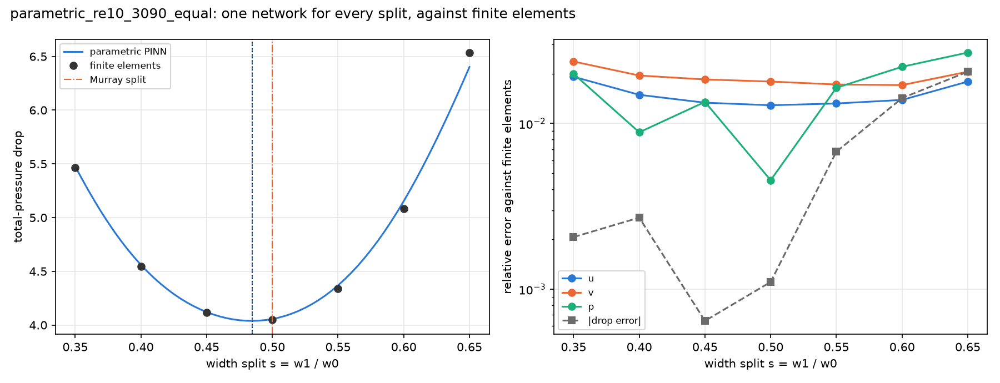

# Supplementary material

This material supports the main text. [Author note: check whether the venue accepts supplementary material or appendices. If it does not, these sections are cut, and the main text's references to S1–S6 go with them.]

## S1. Derivations

Throughout, two daughters share the parent's width (w₁ + w₂ = w₀, s = w₁/w₀) and carry prescribed shares q and 1 − q. Quantities are per unit depth, and each channel is treated as fully developed plane Poiseuille flow unless stated otherwise, with Δp = 12μQL/w³ (Zhou et al., 2024).

### S1.1 Why the flow shares must be prescribed

With both outlets at the same pressure and daughters of equal length L, the daughters are parallel resistances with total conductance:

```latex
G = \frac{w_1^3 + w_2^3}{12\mu L} = \frac{w_0^3}{12\mu L}\left[s^3 + (1-s)^3\right], \qquad \frac{d}{ds}\left[s^3 + (1-s)^3\right] = 6s - 3
```

G is smallest at s = ½ and grows monotonically toward either bound, so the pressure drop Q₀/G falls toward the narrowest branch allowed. That branch then carries q = s³/[s³ + (1 − s)³] = 0.14% of the flow at s = 0.1, against 0.13–0.23% in the finite-element floors (S5.1). Left free, the optimiser simply starves one daughter, so the shares have to be fixed. Unequal lengths weight the two terms by 1/Lᵢ but leave G convex in s, so the conclusion stands.

### S1.2 The Murray split, with and without equal lengths

(a) Fixed total volume. Minimising the dissipation Σ 12μLᵢQᵢ²/wᵢ³ subject to Σ wᵢLᵢ = V, with Lagrange multiplier Λ:

```latex
-\frac{36\mu L_i Q_i^2}{w_i^4} = \Lambda L_i \;\Longrightarrow\; \frac{Q_i}{w_i^2} = \text{const} \;\Longrightarrow\; w_i \propto Q_i^{1/2}
```

The lengths cancel, so the result holds whatever the channel lengths. It is the planar square law of Stephenson et al. (2015) and Zhou et al. (2024).

(b) This study: w₁ + w₂ = w₀, shares prescribed. The parent term is fixed, so only the daughters' dissipation D varies:

```latex
D = 12\mu\left(\frac{L_1 Q_1^2}{w_1^3} + \frac{L_2 Q_2^2}{w_2^3}\right), \qquad \frac{w_1}{w_2} = \left(\frac{L_1}{L_2}\right)^{1/4}\left(\frac{Q_1}{Q_2}\right)^{1/2} \;\xrightarrow{\;L_1 = L_2\;}\; s_M = \frac{\sqrt{q}}{\sqrt{q} + \sqrt{1-q}}
```

The width constraint is not weighted by length, so the lengths cancel only when they are equal. With equal lengths the constraint fixes the daughters' total volume, so s_M has the proportions of (a) but a smaller total than the square law. Substituting wᵢ = w₀√qᵢ/S, with S = √q + √(1 − q), gives the daughters' drop per unit flow, 1.5νL_dQ₀S⁴ for w₀ = 2. With the parent's 12νL_pQ₀/w₀³ this gives J_M = 6.4 + 0.6 = 7.0 at q = 0.5.

(c) Where the angles enter. In this model the junction costs nothing, so the angles can affect the optimum only through the lengths they imply; Murray's (1926a) branching-angle analysis works this way. The design study fixes each daughter's outer wall, not its centreline, so the centreline lengths L₁ and L₂ change with the angles and with s. The length-corrected split s_L solves the relation in (b) with the centreline lengths of the geometry at s_L itself, by fixed-point iteration from s_M to a tolerance of 10⁻¹².

(d) How length is counted. A daughter is a strip of uniform width whose entrance, from its outer corner to the septum tip, is oblique and whose outlet is square to its walls. Its centreline length is therefore the mean of its outer-wall length L_d and its inner-wall length, and it also equals the strip's area divided by its width (the midline of a trapezoid), so neither gives an independent definition. The independent alternative is the closed length, min(L_d, inner-wall length), over which the daughter has both walls; upstream of it the strip is open to the junction on one side. At 0/150 and s = 0.5 the straight daughter's lengths are 8 (outer wall), 6.13 (centreline) and 4.27 (closed), and the turned daughter's 8, 9.87 and 8. Both definitions are used in S5.2 and S5.3. The inner-wall length alone, the other bracket, over-corrects in most layouts (docs/bifurcation_re10-baselines.md).

### S1.3 How flat the optimum is, and how mesh or network error moves it

In units of 12μLQ₀²/w₀³, for daughters of equal length L, the daughters' dissipation and its curvature are:

```latex
\hat D(s) = \frac{q^2}{s^3} + \frac{(1-q)^2}{(1-s)^3}, \qquad \hat D''(s) = 12\left[\frac{q^2}{s^5} + \frac{(1-q)^2}{(1-s)^5}\right], \qquad \frac{\hat D''}{\hat D}\bigg|_{s_M} = \frac{12}{s_M(1-s_M)}
```

The ratio is 48 at q = ½ and about 79 at q = 0.05. The parent's fixed dissipation lowers it for the total objective: J″/J = 48 × 6.4/7.0 = 43.9 at q = ½ by the friction law, against 44.1 measured by finite elements, and 38 for the shorter daughters of the parametric study (L_d = 4). With unequal lengths each term carries Lᵢ/L; the J″/J used for the bounds of S1.9 is measured, so it includes them.

- Cost of a split error. J/J* ≈ 1 + ½(J″/J)δs², so δs = 0.01 costs about 0.22%.
- Where an approximate J puts the minimum. If a network or a coarser mesh gives Ĵ = J(1 + e(s)), its minimum moves by δs* ≈ −e′(s*)/(J″/J). An error that changes by 1% of J over Δs = 0.1 has e′ = 0.1, so δs* ≈ 0.1/44 ≈ 0.002. The value of e itself does not enter.
- Equal widths against the optimum. At q = 0.05, D̂(½) = 7.24 and D̂(s_M) ≈ 2.06, so the friction law alone predicts a 71.5% saving in the daughters' dissipation for every layout. This number is the friction law's arithmetic, not a finding of the resolved study.

The flatness is the planar counterpart of Hagmeijer and Venner's (2018) single-channel result (Theorem 1, Eq. 40).

### S1.4 Wall shear at the Murray split

For plane Poiseuille flow with mean velocity U = Q/w, the wall shear and the daughters' shear ratio are:

```latex
\tau_w = \frac{6\mu Q}{w^2}, \qquad \frac{\tau_1}{\tau_2} = \frac{q}{1-q}\left(\frac{1-s}{s}\right)^2, \qquad \frac{d}{ds}\ln\frac{\tau_1}{\tau_2} = -\frac{2}{s(1-s)}
```

At s_M, q/s² = (1 − q)/(1 − s)², so τ₁ = τ₂: the two daughters carry the same wall shear. This is the planar counterpart of Emerson et al.'s (2006) Eq. 6 and of Hagmeijer and Venner's (2018) wall-shear result. At q = 0.05 (s_M ≈ 0.187), a split 0.010 away from s_M changes the shear ratio by about 13%.

### S1.5 The junction-loss model (basis for H2)

Model the extra loss of daughter i as a coefficient times its dynamic pressure, Kᵢ · ½ρUᵢ² with Uᵢ = Qᵢ/wᵢ (Wechsatol et al., 2006). The addition to the flux-weighted objective, and its slope, are:

```latex
J_j(s) = \frac{\rho Q_0^2}{2 w_0^2}\left[\frac{K_1 q^3}{s^2} + \frac{K_2 (1-q)^3}{(1-s)^2}\right], \qquad J_j'(s) = \frac{\rho Q_0^2}{w_0^2}\left[-\frac{K_1 q^3}{s^3} + \frac{K_2 (1-q)^3}{(1-s)^3}\right]
```

With equal lengths, q = ks² and 1 − q = k(1 − s)² at s_M, so J_j′(s_M) < 0, and the optimum moves to a wider daughter 1, exactly when:

```latex
K_1\, s_M^3 > K_2\, (1-s_M)^3 \quad\Longleftrightarrow\quad \frac{K_1}{K_2} > \left(\frac{1-s_M}{s_M}\right)^3
```

To first order the shift is δs ≈ −J_j′(s_M)/J″(s_M). With K₁ = K₂ the condition reduces to q > ½, so the higher-flow daughter widens; with K₂ > K₁, daughter 2 widens unless daughter 1 carries enough of the flow.

Three quantitative tests use this model (Section 4.1, S5.2). In the first, one K per symmetric layout is fitted to that layout's eleven optima with centreline lengths, K(α) = a + b(1 − cos α) is fitted through those values, and the model then predicts the asymmetric layouts' optima, which were not used. In the second, the coefficients are measured from each optimum's path drops (S1.10) and the model, with closed lengths, is minimised over s. The third compares the shares at which s* − s_M changes sign with those of each model.

### S1.6 The objective, and energy consistency without reference data

The objective is the flux-weighted total-pressure drop:

```latex
\Delta\bar p_t = \bar p_{t,in} - \left[q\,\bar p_{t,1} + (1-q)\,\bar p_{t,2}\right], \qquad \bar p_{t,b} = \frac{1}{Q_b}\int_b \left(p + \tfrac{1}{2}\rho|\mathbf{u}|^2\right)|\mathbf{u}\cdot\mathbf{n}|\,ds
```

For steady incompressible flow, take the dot product of the momentum equation with u and integrate over the domain. No-slip walls contribute nothing. Because ∇·u = 0, the viscous term differs from the dissipation only by boundary terms on the inlet and outlets, and these vanish where the flow there is fully developed. The result is the macroscopic mechanical energy balance (Bird et al., 2002, §7.4):

```latex
Q_0\,\Delta\bar p_t = \Phi = 2\mu\int_\Omega \mathbf{e}:\mathbf{e}\;dA \;\ge\; 0
```

So Δp̄_t is the pumping power per unit flow, and minimising it minimises dissipation. Computing both sides from a field gives a check that needs no reference solution. For the finite-element reference the inconsistency is (4–10) × 10⁻⁶. For Network 2, any momentum residual R adds ∫u·R to the difference.

### S1.7 Reynolds numbers

The parent's centreline velocity is U_c = 1.5U and its half-width is h = w₀/2, so Re_h = U_c h/ν = 0.75Uw₀/ν. For a planar channel D_h → 2w₀ as the depth grows, so Re_Dh = 2Uw₀/ν:

```latex
\frac{Re_{D_h}}{Re_h} = \frac{2}{0.75} = \frac{8}{3} \;\Longrightarrow\; Re_{D_h} \approx 26.7 \text{ at } Re_h = 10
```

Emerson et al. (2006) define Re₀ with the hydraulic diameter of a square channel, so the comparison of Re_Dh ≈ 27 with their Re₀ ≤ 25 is made on a hydraulic-diameter basis. Per unit depth Q₀ = (4/3)U_c h, so Re_h = 3Q₀/(4ν). For daughter i, Re_h,i = 0.75Qᵢ/ν: each daughter's Reynolds number is its share times the parent's, whatever its width.

### S1.8 Murray's cost and the area price

The width-rule study prices each design by pumping power plus a cost per unit channel area A:

```latex
C = Q_0 J + b A, \qquad b = \frac{36\,\nu Q_0^2}{w_0^4}
```

For a single channel of width w and length L carrying Q₀, C/L = 12νQ₀²/w³ + bw, which is smallest where b = 36νQ₀²/w⁴. Setting that width to w₀ gives the price above (0.4 in this study's units), so the parent's own width is optimal for its flow.

### S1.9 Locating the optimum: the mesh bound

The search returns s* on the coarse mesh to within ±0.001, the Brent tolerance. A mesh error that varies with s moves the minimum further (S1.3): if the fine mesh gives J_f(s) = J_c(s)(1 + e(s)), its minimum lies at s* + δs with δs ≈ −e′(s*)/(J″/J). The fine-mesh re-solves of Section 3.2 give e at s* and at the two bracketing grid points. Then e′ is the slope of the least-squares line through those three values, and J″/J the curvature of the parabola through the coarse values at the same points, divided by J*. The location bound is |δs| + 0.001. Over the 165 optima |δs| has median 1 × 10⁻⁵ and maximum 9.2 × 10⁻⁴ (30/150 at q = 0.1), so the bound is 0.001 except at 60/120 (0.0011) and 30/150 (up to 0.0019). A departure larger than its bound is called resolved. The bound covers the search and the coarse mesh's error relative to the fine one, not any error the two meshes share.

### S1.10 Loss coefficients from path drops

Path i runs from the inlet to outlet i. Its drop in flux-weighted total pressure, Δp̄_t,i = p̄_t,in − p̄_t,i, recombines with the other path's to J to 10⁻¹² (S3). Removing fully developed friction in the parent and along a length ℓᵢ of daughter i, and dividing by the daughter's dynamic pressure, gives its loss coefficient, in units of ρU_c²:

```latex
K_i = \frac{\Delta\bar p_{t,i} - 12\nu Q_0 L_p/w_0^3 - 12\nu q_i Q_0 \ell_i/w_i^3}{\tfrac{1}{2}U_i^2}, \qquad U_i = \frac{q_i Q_0}{w_i}
```

With ℓᵢ the centreline length, 75 of the 330 coefficients are negative: 20 of 22 in 0/150, 18 of 22 in 30/120, and some in six other layouts below 180°. The centreline over-counts the friction of a daughter whose septum tip lies downstream of its outer corner, because upstream of the tip its strip is open to the junction. With ℓᵢ the closed length (S1.2d) none is negative. The two differ by an exact amount, so no new solve is needed:

```latex
K_i^{\,x} - K_i^{\,c} = \frac{12\nu q_i Q_0\,(\ell_i^{\,c} - \ell_i^{\,x})/w_i^3}{\tfrac{1}{2}U_i^2}
```

where c and x denote centreline and closed. A coefficient defined this way includes the junction region's own friction and the flow's development in the daughter, so it describes the whole junction and entrance, not a turn alone.

## S2. Geometry rules

A geometry is refused, never silently altered, when:

- an angle lies outside [0°, 180°), or both angles are zero;
- a width, or the opening through which a daughter is entered (measured from the parent's corner to the septum), is below w_min = 0.2;
- the daughters overlap, or the septum tip lies upstream of x = L_p;
- the inner walls meet beyond an outlet;
- the polygon intersects itself.

In the design study a refused split counts as J = +∞ and its reason is recorded. Every vertex is written without branching on values, so every boundary position is differentiable with respect to w₁, w₂, α₁ and α₂; the parametric Network 2 relies on this.

## S3. Verification

**Finite-element reference.** The underlying solver reproduces Poiseuille flow to round-off and converges on Kovasznay flow at third order in velocity and second in pressure, as Taylor–Hood theory predicts. On the bifurcation the test suite requires mass conservation to 10⁻¹² and an energy consistency (S1.6) below 10⁻³ on a coarse mesh; equal shares, to 10⁻⁴, in a mirror-symmetric geometry; no change, to 10⁻¹⁰, when the share the flow chose freely is prescribed; per-path drops that recombine to J to 10⁻¹²; and convergence of J under mesh refinement. The inlet profile is applied only on the inlet segment, never on the line x = 0: a daughter turned back beyond about 112° crosses that line, and an earlier version that used it produced a 152% mass error. Every solve now refuses a solution whose wall velocity is not exactly zero.

The reference used to score Network 2 has maximum element area 0.002 and six corner rounds: 28,399 triangles, 129,562 unknowns, 37 s per solve and an energy consistency of 7.5 × 10⁻⁶. The design study's meshes have 2,852 triangles (coarse, 30/90 at s = 0.5) and 12,837 (fine). The study took about one hour on four processes: 4,381 coarse and 526 fine solves, a median of 76 s per optimisation.

**Network 2.** The parametric network's wall segments equal the fixed-geometry construction at every split tested, and with its s-inputs switched off it reproduces the fixed-geometry network's field and loss to 2 × 10⁻¹⁵. Training is resumable bit for bit.

## S4. Network details

**Network 1.** Width 40, depth 4 (5,403 parameters). An exponential map of x gives the entrance region more of the network's input. Momentum, continuity, the inlet profile and the outlet condition are least-squares terms of equal weight. Training: Adam (Kingma & Ba, 2015) for 3,000 steps with fresh points every 250; four cycles of L-BFGS (Liu & Nocedal, 1989); 800 Levenberg–Marquardt steps with fresh points at every step and Nielsen's damping rule (Madsen et al., 2004); and a 100-step polish on 16,384 points, with the mean of the last 20 iterates as a candidate (Polyak & Juditsky, 1992). The network kept has the lowest loss on 32,768 held-out points from an independent random stream; three seeds were trained. Errors are integrated on the reference's own mesh, because a uniform grid over-weights the singular inlet corners.

**Network 2.** 5,363 parameters including the outlet offset Δp₁. The walls form three chains separated by the openings: the parent's lower wall with daughter 2's outer wall; the septum; and daughter 1's outer wall with the parent's upper wall. Collinear edges are merged, because a 180° joint gives the composed distance a spurious 1/r Laplacian. Each chain is extended 0.5 beyond each opening, outside the domain, because the stream function needs third derivatives of D, which are large where a segment ends. G uses Shepard weights w_k = Π_{j≠k} D_j²; because their exponent is at least 2 and the correction carries D², both velocity components vanish on the walls. The loss sums, with unit weights, the squared x- and y-momentum residuals at interior points, the inlet velocity against the profile, the do-nothing traction at outlet 2, and the traction plus the trained offset at outlet 1. Each draw has 8,192 interior points, a further 10% placed uniformly by area within 0.5 of the reflex corners, and 256 points on the inlet and on each outlet. Training: Adam for 3,000 steps; four L-BFGS cycles, each on a fresh draw; and 150 Levenberg–Marquardt steps with fresh points and iterate averaging.

Network 2 was developed in three stages on one geometry (30/90, s = 0.5, q = 0.5, L_d = 4). Table S1 compares them.

**Table S1.** The three formulations of Network 2 (reference solve: 37 s).

|  | Velocity–pressure | Stream function | Stream function, walls extended |
| --- | --- | --- | --- |
| u, v, p (relative L2) | 2.5e-2, 1.1e-1, 1.5e-1 | 1.9e-2, 2.6e-2, 5.2e-3 | 9.0e-3, 1.3e-2, 6.3e-3 |
| Pressure-drop error | −4.5% | −0.40% | +0.42% |
| Mass imbalance | −6.3% | exact | exact |
| Outlet offset Δp₁ (reference 0.542) | −0.023 | 0.555 | 0.556 |
| Training time | 70 min | 101 min | 90 min |

**Parametric Network 2.** The input is (x, y, s). Outlet 1's offset becomes a degree-4 Chebyshev series in s. Each draw takes 16 splits, stratified across [0.35, 0.65], with 1,024 interior points in each split's own polygon. Once trained, the network gives J(s) from line integrals alone.

**Network 3.** Width 16, depth 2. With N the network, its first output's antisymmetric part c (under swapping the daughters) and its second output's symmetric part d correct the friction law:

```latex
s = s_{lo} + (s_{hi} - s_{lo})\,\sigma\!\left(\operatorname{logit}\frac{s_M - s_{lo}}{s_{hi} - s_{lo}} + c\right), \qquad J = J_M\, e^{d}
```

with [s_lo, s_hi] = [0.1, 0.9]. The targets are the coarse-mesh optima s* and the fine-mesh drops J*, and the objective is

```latex
\sum \left(\frac{s - s^*}{0.001}\right)^2 + \sum \left(\frac{\ln J - \ln J^*}{0.001}\right)^2 + \beta \lVert\theta\rVert^2
```

minimised by Levenberg–Marquardt (Moré, 1978; Virtanen et al., 2020). β = 1,000 was chosen from {100, 1,000, 10,000} by leave-one-layout-out cross-validation, and the network was then refitted on all 165 optima (3.8 h on four cores, cross-validation included). For validation, three splits were solved by finite elements at each of the six held-out angle pairs (45/75, 15/105, 75/105, 45/135, 30/30 and 0/90) and q = 0.2, 0.5 and 0.8: the network's, the Murray split, and the optimum found by the full procedure of Section 3.2.

## S5. Further results

### S5.1 Quality of the design map

The map holds 180 optimisations: 15 layouts × 11 prescribed shares, plus the equal-pressure floor of each layout. All 180 minima survive refinement to elements a quarter of the area. The relative change in the optimal pressure drop, |J*_fine − J*_coarse|/J*_fine, has median 1.1 × 10⁻⁴, 95th percentile 1.3 × 10⁻³ and maximum 1.0 × 10⁻² (30/150 at q = 0.05). Delivered shares equal the prescribed ones to 3.3 × 10⁻¹⁶, no prescribed-share optimum lies on a width bound, and J* ranges from 3.78 to 12.15 in units of ρU_c². With equal outlet pressures, the lowest drop in every layout lies at the most unequal split allowed, J = 2.76–3.50, where the narrow daughter carries 0.13–0.23% of the flow (S1.1).

### S5.2 Departures, bounds and regret by layout

**Table S2.** Departures, bounds and regret by layout. s_L uses centreline (c) or closed (x) lengths (S1.2d); at 180° both lengths equal L_d and s_L = s_M. The bound is the mesh-induced argmin shift plus the ±0.001 search tolerance (S1.9). Regret is J at the proposed split over J*, minus 1, on the search mesh, whose noise is about 10⁻⁴.

| Layout | Largest s* − s_M | Squared departure removed by s_L, c / x | Largest s* − s_L, c / x | Largest bound | Beyond the bound: s_M / s_L c / s_L x | Murray regret, median and max | Largest s_L regret, c / x |
| --- | --- | --- | --- | --- | --- | --- | --- |
| 15/15 | 0.0023 | 59% / 5% | 0.0016 / 0.0023 | 0.0010 | 7/11 / 5/11 / 7/11 | 0.0067%, 0.014% | 0.0061% / 0.013% |
| 0/30 | 0.0040 | 78% / 78% | 0.0018 / 0.0018 | 0.0010 | 8/11 / 5/11 / 5/11 | 0.0091%, 0.043% | 0.011% / 0.011% |
| 20/40 | 0.0035 | 84% / 52% | 0.0016 / 0.0019 | 0.0010 | 10/11 / 2/11 / 10/11 | 0.0083%, 0.033% | 0.005% / 0.0097% |
| 0/60 | 0.0073 | 92% / 94% | 0.0021 / 0.0018 | 0.0010 | 9/11 / 7/11 / 7/11 | 0.048%, 0.13% | 0.012% / 0.010% |
| 45/45 | 0.0026 | 96% / 36% | 0.0006 / 0.0018 | 0.0010 | 8/11 / 0/11 / 8/11 | 0.0091%, 0.025% | 0.0021% / 0.012% |
| 10/80 | 0.0098 | 95% / 95% | 0.0019 / 0.0025 | 0.0010 | 9/11 / 6/11 / 5/11 | 0.085%, 0.24% | 0.012% / 0.020% |
| 60/60 | 0.0048 | 85% / 62% | 0.0021 / 0.0030 | 0.0010 | 9/11 / 5/11 / 9/11 | 0.015%, 0.073% | 0.0062% / 0.018% |
| 30/90 | 0.0126 | 96% / 91% | 0.0025 / 0.0037 | 0.0010 | 10/11 / 9/11 / 8/11 | 0.10%, 0.41% | 0.023% / 0.037% |
| 0/120 | 0.0233 | 91% / 97% | 0.0080 / 0.0048 | 0.0010 | 11/11 / 9/11 / 9/11 | 0.72%, 1.2% | 0.14% / 0.071% |
| 75/75 | 0.0134 | 96% / 80% | 0.0026 / 0.0056 | 0.0010 | 8/11 / 6/11 / 8/11 | 0.15%, 0.42% | 0.012% / 0.055% |
| 30/120 | 0.0427 | 89% / 95% | 0.0144 / 0.0094 | 0.0010 | 11/11 / 9/11 / 11/11 | 1.7%, 3.8% | 0.59% / 0.16% |
| 0/150 | 0.0721 | 78% / 96% | 0.0353 / 0.0128 | 0.0010 | 11/11 / 11/11 / 11/11 | 5.1%, 8.9% | 2.7% / 0.27% |
| 90/90 | 0.0014 | — | = s_M | 0.0010 | 3/11 / 3/11 / — | 0.0031%, 0.014% | = Murray |
| 60/120 | 0.0025 | — | = s_M | 0.0011 | 1/11 / 1/11 / — | 0.00029%, 0.023% | = Murray |
| 30/150 | 0.0059 | — | = s_M | 0.0019 | 4/11 / 4/11 / — | 0.0047%, 0.21% | = Murray |

Murray regret over all 165 optima: median 0.016%, maximum 8.9%; up to 90°, median 0.011% and maximum 0.24%; at 120° and 150°, median 0.34% and maximum 8.9%; at 180°, median 0.0025% and maximum 0.21%. Over the 132 optima below 180°, s_L with centreline lengths costs a median of 0.0029% and at most 0.023% where no daughter turns beyond 90° (99 optima), and a median of 0.13% and at most 2.7% where one turns back (33); with closed lengths, 0.0065% and 0.055%, and 0.087% and 0.27%. Equal widths cost a median of 56% over the optimum. In the symmetric layouts the higher-flow daughter is wider than s_M because the septum tip moves toward the narrower daughter, lengthening the wider one; s_L captures this. The 0.01 threshold for H1, set after the first results, is exceeded by the symmetric 75/75 layout (0.013 at q = 0.95).

**Table S3.** Loss coefficients and the junction-loss model by layout (S1.5, S1.10). K is measured at each optimum against friction along centreline (c) or closed (x) lengths. The last three columns give the largest |s* − s| over the eleven shares for three models: centreline friction plus K(α) fitted on the symmetric layouts (not applied at 180°); closed-length friction alone; and closed-length friction plus each optimum's own closed coefficients. The last two are minimised over s with the lengths of each geometry, so the closed-lengths column differs slightly from the fixed-point s_L of Table S2.

| Layout | Negative K, c / x | K₁, K₂ at q = 0.5, c | K₁, K₂ at q = 0.5, x | Largest s* − s_model: K(α), c | Closed lengths only | Closed lengths and own K |
| --- | --- | --- | --- | --- | --- | --- |
| 15/15 | 0/22 / 0/22 | 0.61, 0.61 | 0.85, 0.85 | 0.0011 | 0.0021 | 0.0019 |
| 0/30 | 0/22 / 0/22 | 0.49, 0.57 | 0.97, 1.06 | 0.0015 | 0.0027 | 0.0027 |
| 20/40 | 0/22 / 0/22 | 0.73, 0.49 | 0.79, 1.28 | 0.0015 | 0.0016 | 0.0013 |
| 0/60 | 3/22 / 0/22 | 0.31, 0.65 | 1.37, 1.69 | 0.0016 | 0.0034 | 0.0033 |
| 45/45 | 0/22 / 0/22 | 0.63, 0.63 | 1.37, 1.37 | 0.0008 | 0.0018 | 0.0010 |
| 10/80 | 3/22 / 0/22 | 0.49, 0.41 | 1.71, 2.16 | 0.0020 | 0.0039 | 0.0041 |
| 60/60 | 2/22 / 0/22 | 0.63, 0.63 | 1.67, 1.67 | 0.0022 | 0.0015 | 0.0022 |
| 30/90 | 9/22 / 0/22 | 0.93, −0.21 | 2.03, 2.36 | 0.0032 | 0.0048 | 0.0053 |
| 0/120 | 8/22 / 0/22 | −0.96, 0.31 | 2.41, 3.43 | 0.0061 | 0.0061 | 0.0053 |
| 75/75 | 12/22 / 0/22 | 0.60, 0.60 | 1.98, 1.98 | 0.0038 | 0.0049 | 0.0058 |
| 30/120 | 18/22 / 0/22 | −1.29, −2.51 | 3.52, 3.30 | 0.0133 | 0.0124 | 0.0106 |
| 0/150 | 20/22 / 0/22 | −4.65, −2.17 | 3.77, 4.55 | 0.0331 | 0.0142 | 0.0096 |
| 90/90 | 0/22 / 0/22 | 2.29, 2.29 | 2.29, 2.29 | — | — | — |
| 60/120 | 0/22 / 0/22 | 1.47, 4.42 | 1.47, 4.42 | — | — | — |
| 30/150 | 0/22 / 0/22 | 0.92, 17.30 | 0.92, 17.30 | — | — | — |

**The three tests of H2's mechanism.** (1) Measured coefficients (Table S3). Against centreline friction, 75 of the 330 coefficients are negative and those of the symmetric layouts do not grow with turning (0.60–0.63 at q = 0.5 from 15/15 to 75/75). Against closed friction none is negative; they grow from 0.85 at 15/15 to 1.98 at 75/75, and the more-turned daughter has the larger coefficient in seven of the eight asymmetric layouts below 180°, as H2 requires. Yet with each optimum's own closed coefficients the model still misses the turned-back optima by up to 0.011, little better than closed lengths alone (0.014). (2) Fitted coefficients. One K per symmetric layout, fitted to its eleven optima with centreline lengths: 15/15, 0.57 (rms residual 0.0002, against 0.0012 with lengths only); 45/45, 0.17 (0.0001 against 0.0004); 60/60, 0.12 (0.0007 against 0.0008); 75/75, 1.14 (0.0018 against 0.0029). These vary without order, but the residuals they are fitted to are at most 0.0026 against a ±0.001 bound, so the fit cannot resolve them. The line K(α) = a + b(1 − cos α), with a = 0.22 and b = 0.71, changes no layout's largest residual by more than 0.0022. (3) Reversal shares (Table S4). The departure changes sign at q = 0.6–0.7 in 20/40, 0.7–0.8 in 0/30 and 0.8–0.9 in 30/90, against 0.8–0.9, none and 0.9–0.95 from the lengths and 0.7–0.8, none and none from the junction model; since the positive departures are at most 0.0018, these shares are known only to about ±0.1 in q. At 180° the coefficients are large and unequal (0.92 and 17.3 at 30/150, q = 0.5), yet the optimum lies beyond its bound of s_M in only 8 of 33 optima; we have no model for this junction.

**Table S4.** Shares between which s* − s_M turns from negative to positive, in the asymmetric layouts up to 120° where it does. Reversals are resolved only to about ±0.1 in q, since the positive departures are at most 0.0018.

| Layout | Observed | Lengths alone (s_L) | Lengths and junction model |
| --- | --- | --- | --- |
| 0/30 | 0.7–0.8 | none | none |
| 20/40 | 0.6–0.7 | 0.8–0.9 | 0.7–0.8 |
| 0/60 | 0.9–0.95 | none | none |
| 10/80 | 0.9–0.95 | none | none |
| 30/90 | 0.8–0.9 | 0.9–0.95 | none |

### S5.3 Savings and orientation

The optimal split lowers the pressure drop relative to equal widths by up to 71.5% (0/150, q = 0.05), close to the friction law's 71.5% (S1.3). At equal shares the saving is 4.8% at 0/150, 1.7% at 30/120, 0.7% at 0/120, and below 0.002% in the symmetric layouts. At equal shares the resolved optimum costs more than the friction-law estimate J_M = 7.0 in twelve layouts, by 1.5–29%, and less in the three most strongly turned: by 1.6% at 0/120, 4.2% at 30/120 and 13.3% at 0/150. Centreline lengths explain only part of this. Evaluated at the optimum with them, the friction law gives 6.92 at 0/150 against J* = 6.07, and over all shares J* falls below it in five layouts, by up to 20%. Closed lengths explain it: the straight daughter of 0/150 has both walls over only 3.8 of its 8 units at the optimum (5.9 along its centreline), the rest of its strip being open to the junction, and with closed lengths every optimum lies at least 1.9% above the friction law, as positive junction and entrance losses would make it.

**Table S5.** Spread of J* between layouts with the same bifurcation angle.

|  | 30° | 60° | 90° | 120° | 150° | 180° |
| --- | --- | --- | --- | --- | --- | --- |
| At q = 0.5 | 1.0% | 1.8% | 2.1% | 7.0% | 22.6% | 20.3% |
| Largest over all shares | 1.5% | 2.4% | 3.3% | 7.4% | 23.1% | ×2.7 |

The factor of 2.7 at 180° compares 30/150 with 90/90 at q = 0.05: J* = 12.15 when 95% of the flow must turn back by 150°, against 4.56 when it turns by 90°.

### S5.4 The width rules

Pressure drop alone has no optimum in total width: at 60/60 and q = 0.5, J falls from 7.37 at w₁ + w₂ = w₀ to 3.06 at 1.41w₀ and 1.57 at 2w₀. Under Murray's cost (S1.8) the total-width scan, at the Murray proportions, has a minimum. A parabola through the points around it places the minimum at k = (w₁ + w₂)/w₀ = 1.42–1.43 for 60/60 and 1.37–1.38 for 0/150.

**Table S6.** Murray cost at q = 0.5 against the daughters' combined width.

| k | 1.0 | 1.2 | 1.3 | 1.414 | 1.5 | 1.6 | 2.0 |
| --- | --- | --- | --- | --- | --- | --- | --- |
| 60/60 | 19.09 | 16.71 | 16.28 | 16.15 | 16.22 | 16.42 | 17.98 |
| 0/150 | 18.79 | 17.03 | 16.77 | 16.75 | 16.87 | 17.12 | 18.73 |

Across five layouts (60/60, 30/90, 0/120, 0/150 and 90/90), the planar square law has a Murray cost lower than w₁ + w₂ = w₀ by 10.6–15.4% at q = 0.5 and by 5.2–10.6% at q = 0.2. The round-pipe cube law costs 1.3–2.8% more than the square law. All 68 geometries were valid, and the shared-optimum rows reproduced the design study's drops exactly.

### S5.5 Wall shear at the optimum

**Table S7.** Largest wall-shear mismatch between the daughters at the resolved optimum, max(τ₁/τ₂, τ₂/τ₁) − 1, over the eleven shares. In every layout it occurs at the most unequal shares.

| Bifurcation angle | Layouts (largest mismatch) |
| --- | --- |
| ≤ 90° | 15/15 3%, 0/30 5%, 20/40 5%, 0/60 8%, 45/45 4%, 10/80 12% |
| 120° | 60/60 7%, 30/90 18%, 0/120 31% |
| 150° | 75/75 20%, 30/120 71%, 0/150 ×2.6 |
| 180° | 90/90 2%, 60/120 3%, 30/150 8% |

### S5.6 Network 1

**Table S8.** Network 1 against the channel reference (relative L2 errors; mean and range over three seeds).

|  | u | v | p | Total-pressure drop | Energy budget (network alone) |
| --- | --- | --- | --- | --- | --- |
| Network 1 | 3.3 × 10⁻⁶ (2.7–4.0) | 7.1 × 10⁻⁵ | 1.7 × 10⁻⁵ | 3.9 × 10⁻⁶ (0.55–7.2) | 2.6 × 10⁻⁶ |
| Reference's own error | 8.7 × 10⁻⁷ | 9.8 × 10⁻⁶ | 1.5 × 10⁻⁵ | 6.7 × 10⁻⁸ | 1.5 × 10⁻⁷ |

The baseline setup, Adam and L-BFGS only, reached 2.83 × 10⁻⁴ in u and 1.36 × 10⁻⁴ in the objective. The 99% entrance length, where the centreline first reaches 99% of its developed value, is 1.7795 half-widths in all three seeds, against 1.7794 for the reference. Durst et al.'s (2005) correlation gives 1.88, but it assumes an exactly uniform inlet and uses its own Reynolds-number definition, whereas this inlet is u = U₀(1 − y¹⁶); the two are therefore not directly comparable.

### S5.7 The reference-free energy check

**Table S9.** Energy inconsistency against the true errors. The reference's own inconsistency on these meshes is (4–10) × 10⁻⁶.

| Network | Split s | Energy inconsistency | Pressure-drop error | Dissipation error |
| --- | --- | --- | --- | --- |
| Velocity–pressure | 0.50 | 5.2% | −4.5% | −9.5% |
| Stream function | 0.50 | 1.6% | −0.40% | +1.2% |
| Walls extended | 0.50 | 0.14% | +0.42% | +0.28% |
| Parametric | 0.35 | 0.31% | +0.21% | +0.51% |
| Parametric | 0.40 | 0.15% | +0.27% | +0.42% |
| Parametric | 0.45 | 0.32% | +0.06% | +0.39% |
| Parametric | 0.50 | 0.26% | +0.11% | +0.37% |
| Parametric | 0.55 | 0.29% | +0.68% | +0.39% |
| Parametric | 0.60 | 0.96% | +1.42% | +0.46% |
| Parametric | 0.65 | 2.6% | −2.05% | +0.57% |

The ratio of the inconsistency to the true pressure-drop error ranges from 0.33 to 5.0, with median 1.2. Its rank correlation with the true error over the ten cases is ρ = 0.53 (Spearman; not significant at n = 10). The two stream-function runs had nearly equal drop errors (0.40% and 0.42%) but inconsistencies of 1.6% and 0.14%: the check follows the momentum residual weighted by the velocity, which the better run reduced, rather than the objective.

### S5.8 The parametric Network 2

Trained once over s ∈ [0.35, 0.65], the network predicts the pressure drop within 0.06–0.11% at s = 0.45–0.50 and within 0.2–0.3% at s = 0.35–0.40, with errors of +0.68% at 0.55, +1.42% at 0.60 and −2.05% at 0.65. Its u error is 1.3–1.9% across the range; mass and the share are exact at every split. Training took 215 min.

**Table S10.** The optimal split by each route (30/90, q = 0.5, L_d = 4).

|  | Optimal split s* | Lowest drop J* |
| --- | --- | --- |
| Parametric Network 2 | 0.4845 | 4.0385 |
| Finite elements | 0.4848 | 4.0358 |
| Difference | −0.0003 | +0.07% |

Both optima were searched to ±0.002 in s. Adopting the network's split costs 0.0004% in pressure drop, below the 0.01% resolution of the search.



**Figure S1.** Left: the parametric Network 2's total-pressure drop across the split range (line) against the finite-element solutions (dots); the dashed and dotted lines mark the network's and the finite-element optimum, both at s ≈ 0.485, and the dash-dot line the Murray split. Right: the network's relative errors in u, v, p and the pressure drop at each evaluation split.

### S5.9 Network 3 and cost

On the 18 held-out cases, Network 3's proposed splits had a regret of 0.016% on average and 0.077% at worst, against 0.109% and 0.70% for the Murray split and 0.015% and 0.087% for the length-corrected split s_L, which costs nothing. On the three 15/105 cases, where a daughter turns back by 105°, the means are 0.37% (Murray), 0.016% (s_L) and 0.016% (Network 3); at the face-septum pairs 75/105 and 45/135, s_L = s_M. Solving at Network 3's splits as reported to four decimals gives 0.016% and 0.075%, within the search noise of about 10⁻⁴. Network 3 predicted the lowest drop to within 0.48% on average and 3.0% at worst; on the same cases the friction law with centreline lengths, at s_L, errs by 5.0% on average and 28% at worst. In leave-one-layout-out cross-validation, held-out split errors were at most 0.009 for layouts inside the sampled range, and below the Murray split's for most. For the layouts at the edge of the angle space (0/120, 0/150, 30/120, 30/150, 60/120), held-out drop errors reached 26–49%. One design query takes 0.02 s, or 13 µs each when 10,000 are batched.

**Table S11.** Cost of each route, on the same four CPU cores.

| Task | Finite elements | Network |
| --- | --- | --- |
| Channel flow (Network 1) | 283 s (finest of four meshes) | 263 min of training |
| One bifurcation (Network 2) | 37 s | 90 min of training |
| One design question, fixed angles and share (parametric Network 2) | 11.4 min (14 solves at the network's mesh) | 215 min of training |
| A map of design questions (Network 3) | 76 s per question | 3.9 core-hours of data and a 3.8 h fit, then 0.02 s per question |

## S6. Code and data availability

&#91;Author note: give the public repository URL here.] The code is in the repository PINN-Optimising_Geometries_Engineering_Project. The design dataset is docs/bifurcation_re10-shares-all.json, with a CSV of the optima in docs/bifurcation_re10-optimum-widths.csv; the length, mesh and junction checks are in docs/bifurcation_re10-sensitivity.json, and the held-out baselines, length definitions, closed-length coefficients and s_L regrets in docs/bifurcation_re10-baselines.json. The modules are developing_flow/pinn.py (Network 1), bifurcation/flow.py (Network 2), bifurcation/parametric.py (parametric Network 2), bifurcation/geometric.py (Network 3), bifurcation/design_study.py (the design study), bifurcation/sensitivity.py (the length, mesh and junction checks), bifurcation/baselines.py (the baselines and length definitions), bifurcation/width_rules.py and bifurcation/energy.py.

## References for the Supplementary material

Bird, R. B., Stewart, W. E., & Lightfoot, E. N. (2002). *Transport phenomena* (2nd ed.). Wiley.

† Durst, F., Ray, S., Ünsal, B., & Bayoumi, O. A. (2005). The development lengths of laminar pipe and channel flows. *Journal of Fluids Engineering, 127*(6), 1154–1160. https://doi.org/10.1115/1.2063088

Emerson, D. R., Cieślicki, K., Gu, X., & Barber, R. W. (2006). Biomimetic design of microfluidic manifolds based on a generalised Murray's law. *Lab on a Chip, 6*(3), 447–454. https://doi.org/10.1039/b516975e ⚠

Hagmeijer, R., & Venner, C. H. (2018). *Critical review of Murray's theory for optimal branching in fluidic networks* (arXiv:1812.09706). arXiv. https://doi.org/10.48550/arXiv.1812.09706

† Kingma, D. P., & Ba, J. (2015). Adam: A method for stochastic optimization. In *Proceedings of the 3rd International Conference on Learning Representations (ICLR 2015)*. https://doi.org/10.48550/arXiv.1412.6980

† Liu, D. C., & Nocedal, J. (1989). On the limited memory BFGS method for large scale optimization. *Mathematical Programming, 45*(1–3), 503–528. https://doi.org/10.1007/BF01589116

† Madsen, K., Nielsen, H. B., & Tingleff, O. (2004). *Methods for non-linear least squares problems* (2nd ed.). Informatics and Mathematical Modelling, Technical University of Denmark.

† Moré, J. J. (1978). The Levenberg–Marquardt algorithm: Implementation and theory. In G. A. Watson (Ed.), *Numerical analysis* (Lecture Notes in Mathematics, Vol. 630, pp. 105–116). Springer. https://doi.org/10.1007/BFb0067700

Murray, C. D. (1926a). The physiological principle of minimum work applied to the angle of branching of arteries. *Journal of General Physiology, 9*(6), 835–841. https://doi.org/10.1085/jgp.9.6.835

† Polyak, B. T., & Juditsky, A. B. (1992). Acceleration of stochastic approximation by averaging. *SIAM Journal on Control and Optimization, 30*(4), 838–855. https://doi.org/10.1137/0330046

Stephenson, D., Patronis, A., Holland, D. M., & Lockerby, D. A. (2015). Generalizing Murray's law: An optimization principle for fluidic networks of arbitrary shape and scale. *Journal of Applied Physics, 118*(17), Article 174302. https://doi.org/10.1063/1.4935288

† Virtanen, P., Gommers, R., Oliphant, T. E., Haberland, M., Reddy, T., Cournapeau, D., Burovski, E., Peterson, P., Weckesser, W., Bright, J., van der Walt, S. J., Brett, M., Wilson, J., Millman, K. J., Mayorov, N., Nelson, A. R. J., Jones, E., Kern, R., Larson, E., . . . SciPy 1.0 Contributors. (2020). SciPy 1.0: Fundamental algorithms for scientific computing in Python. *Nature Methods, 17*(3), 261–272. https://doi.org/10.1038/s41592-019-0686-2

Wechsatol, W., Lorente, S., & Bejan, A. (2006). Tree-shaped flow structures with local junction losses. *International Journal of Heat and Mass Transfer, 49*(17–18), 2957–2964. https://doi.org/10.1016/j.ijheatmasstransfer.2006.01.047

Zhou, B., Cheng, Q., Chen, Z., Chen, Z., Liang, D., Munro, E. A., Yun, G., Kawai, Y., Chen, J., Bhowmick, T., Padmanathan, K. K., Occhipinti, L. G., Matsumoto, H., Gardner, J. W., Su, B.-L., & Hasan, T. (2024). Universal Murray's law for optimised fluid transport in synthetic structures. *Nature Communications, 15*(1), Article 3652. https://doi.org/10.1038/s41467-024-47833-0
