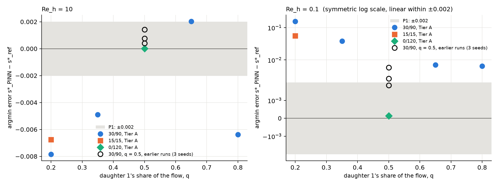

# Tier A: new shares and a symmetric control

Twelve parametric PINN runs, one seed each (21), at Re_h = 0.1 and 10: 30/90 at q = 0.2, 0.35, 0.65 and 0.8; 15/15 at q = 0.2 (the null test); 0/120 at q = 0.5. Rules and pass marks were committed before any screening solve or run (docs/re_study/tierA/preregistration.md). P1: the PINN's optimum within ±0.002 of the reference optimum (Brent on the reference mesh). P2: the reference optimum within 0.003 of the length-corrected split s_L, where no daughter turns beyond 90° (30/90 and 15/15). Both tolerances are the paper's, unchanged. Each trained range is s_L ± 0.15; all twelve cases passed the screening for an interior minimum with daughters 4 long (docs/re_study/tierA/screening.md).

Of the 12 runs reported, 2 pass P1. Of the 10 in P2's scope, 5 pass P2. Verdicts are on the unrounded values; nothing was rerun.

## What Tier A shows

- P1 passes only at q = 0.5: 0/120 at both Reynolds numbers, to within 0.0001. Every run at another share fails it, at both Reynolds numbers, including the symmetric 15/15 null test.
- At Re_h = 10 the misses are moderate and grow with the share's distance from 0.5: −0.0049 at q = 0.35, +0.0020 at 0.65 (failing by 0.00002), −0.0064 at 0.8, −0.0078 at 0.2, and −0.0068 for 15/15 at 0.2. The regret stays below 0.13%, and the pressure-drop error within ±2.6% over each off-centre range (±3.2% for 0/120).
- At Re_h = 0.1 every off-centre run fails, by +0.006 to +0.156 (regret up to 40%; the PINN's optimum always lies above the reference's). Every Tier A run there, 0/120 included, ends at a held-out loss of 1.1 to 22, against 0.12 to 0.16 for the three earlier 30/90 runs at q = 0.5, and with largest drop errors of 8 to 30%; 0/120 (1.1, −8.1% at its range's top) still placed its optimum to 0.0001, because its error was flat near the optimum.
- The 15/15 null test misses by as much as 30/90 at the same share (−0.0068 against −0.0078 at Re_h = 10), so the miss belongs to the share, not to the layout's length asymmetry.
- The share, not the corner-mode cutoff, is the limit (section 5, amendment 1): every off-centre case also had a smaller cutoff, but 30/90 at q = 0.5 passes P1 with its cutoff forced to 0.15 at both Reynolds numbers, and q = 0.35 still fails with it raised to 0.40. The small cutoff costs field accuracy (held-out loss and u error several times higher) without moving the optimum.
- One seed is enough to call the Re_h = 10 misses real (section 5): a second seed of 30/90 at q = 0.2 misses by −0.0085 against seed 21's −0.0078, a spread of 0.0007, about the 0.0005 spread of three seeds at q = 0.5.
- Mechanism (section 6): the slope e′ of the PINN's pressure-drop error at the reference optimum, measured over ±0.01, predicts each argmin error through δs ≈ −e′/(J″/J) within a factor 0.8–1.4 in 13 of 18 runs, and within 0.0003 in three more whose shifts are below 0.0005; it is moderately off at q = 0.65, Re_h = 0.1 (0.68) and fails at q = 0.2, Re_h = 0.1 (2.37), where training collapsed. Off-centre slopes at Re_h = 10 are 17–35% per unit s (5.7% at q = 0.65), against 0.5–5.2% at q = 0.5 (the earlier 30/90 runs and 0/120); at Re_h = 0.1 the earlier q = 0.5 slopes were 5.5–16.4%, and 0/120's 0.14%.
- P2, a property of the reference solution: s_L lies within 0.003 of the optimum at q = 0.35 and 0.65 at Re_h = 0.1, q = 0.35 at 10, and for 15/15 at both; it does not at q = 0.2 and 0.8 for 30/90 (0.004 to 0.006), nor at q = 0.65 at Re_h = 10 (0.0031). The length correction loses accuracy as the share moves from 0.5 in a layout with unequal lengths.

## 1. Every run against the pass marks

| Layout | q | Re_h | PINN s* | Reference s* | Argmin error | P1 | s_L | s*_ref − s_L | P2 | Regret |
|---|---|---|---|---|---|---|---|---|---|---|
| 30/90 | 0.2 | 0.1 | 0.4616 | 0.3060 | +0.1556 | FAIL | 0.3116 | -0.0056 | FAIL | 40.2721% |
| 30/90 | 0.2 | 10 | 0.2978 | 0.3056 | -0.0078 | FAIL | 0.3116 | -0.0060 | FAIL | 0.1257% |
| 30/90 | 0.35 | 0.1 | 0.4394 | 0.4012 | +0.0382 | FAIL | 0.4039 | -0.0027 | pass | 2.4696% |
| 30/90 | 0.35 | 10 | 0.3963 | 0.4012 | -0.0049 | FAIL | 0.4039 | -0.0027 | pass | 0.0391% |
| 30/90 | 0.65 | 0.1 | 0.5750 | 0.5680 | +0.0070 | FAIL | 0.5655 | +0.0025 | pass | 0.0823% |
| 30/90 | 0.65 | 10 | 0.5707 | 0.5686 | +0.0020 | FAIL | 0.5655 | +0.0031 | FAIL | 0.0058% |
| 30/90 | 0.8 | 0.1 | 0.6713 | 0.6649 | +0.0064 | FAIL | 0.6608 | +0.0041 | FAIL | 0.0916% |
| 30/90 | 0.8 | 10 | 0.6590 | 0.6653 | -0.0064 | FAIL | 0.6608 | +0.0045 | FAIL | 0.0750% |
| 15/15 | 0.2 | 0.1 | 0.3859 | 0.3303 | +0.0557 | FAIL | 0.3321 | -0.0018 | pass | 6.4347% |
| 15/15 | 0.2 | 10 | 0.3233 | 0.3300 | -0.0068 | FAIL | 0.3321 | -0.0021 | pass | 0.0966% |
| 0/120 | 0.5 | 0.1 | 0.4527 | 0.4526 | +0.0001 | pass | 0.4709 | -0.0183 | — | -0.0000% |
| 0/120 | 0.5 | 10 | 0.4527 | 0.4527 | +0.0000 | pass | 0.4709 | -0.0181 | — | -0.0000% |

*P1 |argmin error| ≤ 0.002; P2 |s*_ref − s_L| ≤ 0.003, not applied to 0/120 (a daughter turned back). Regret = J_ref(s*_PINN)/J_ref(s*_ref) − 1.*

## 2. Accuracy and training

| Layout | q | Re_h | Corner cutoff | Drop error: low end / middle / high end | Largest |drop error| | u error at s* | Held-out loss | Min | Plateaued |
|---|---|---|---|---|---|---|---|---|---|
| 30/90 | 0.2 | 0.1 | 0.1 | -22.82% / +16.79% / -29.96% | 29.96% | 6.72e-02 | 22 | 163 | yes |
| 30/90 | 0.2 | 10 | 0.1 | -2.54% / +0.74% / -1.67% | 2.54% | 1.39e-02 | 0.0159 | 166 | yes |
| 30/90 | 0.35 | 0.1 | 0.3 | -23.81% / +3.98% / -19.52% | 23.81% | 2.10e-02 | 6.03 | 180 | no |
| 30/90 | 0.35 | 10 | 0.3 | +0.13% / +0.49% / -1.98% | 1.98% | 1.39e-02 | 0.0136 | 185 | yes |
| 30/90 | 0.65 | 0.1 | 0.35 | -5.09% / -0.78% / -8.28% | 8.28% | 7.71e-03 | 1.49 | 160 | no |
| 30/90 | 0.65 | 10 | 0.35 | +0.01% / +0.03% / -1.95% | 1.95% | 1.17e-02 | 0.0137 | 163 | yes |
| 30/90 | 0.8 | 0.1 | 0.15 | -25.54% / +3.92% / -3.62% | 25.54% | 1.32e-02 | 15 | 191 | no |
| 30/90 | 0.8 | 10 | 0.15 | -0.25% / +0.43% / -2.30% | 2.30% | 9.38e-03 | 0.019 | 166 | yes |
| 15/15 | 0.2 | 0.1 | 0.15 | -26.49% / +7.74% / -25.99% | 26.49% | 2.34e-02 | 20.8 | 193 | yes |
| 15/15 | 0.2 | 10 | 0.15 | -2.60% / +0.24% / -1.88% | 2.60% | 7.09e-03 | 0.0115 | 184 | no |
| 0/120 | 0.5 | 0.1 | 0.4 | -5.18% / +0.31% / -8.12% | 8.12% | 1.25e-02 | 1.11 | 170 | yes |
| 0/120 | 0.5 | 10 | 0.4 | +1.14% / -0.18% / -3.19% | 3.19% | 1.17e-02 | 0.00535 | 153 | yes |

*Drop error = J_PINN/J_ref − 1 at the seven evaluation splits. Held-out loss is a diagnostic only, in each run's pressure units (μU_c/h at Re_h 0.1, ρU_c² at 10).*

### Baseline: the earlier 30/90 runs at q = 0.5

Range [0.35, 0.65], corner cutoff 0.5 (the earlier protocol; not part of Tier A).

| Re_h | Seed | Argmin error | Regret | u error at s* | Held-out loss |
|---|---|---|---|---|---|
| 0.1 | 21 | +0.0026 | 0.0115% | 2.34e-03 | 0.119 |
| 0.1 | 22 | +0.0058 | 0.0563% | 2.73e-03 | 0.162 |
| 0.1 | 23 | +0.0018 | 0.0058% | 3.18e-03 | 0.15 |
| 10 | 21 | +0.0014 | 0.0035% | 1.52e-03 | 0.000915 |
| 10 | 22 | +0.0004 | 0.0002% | 2.45e-03 | 0.000931 |
| 10 | 23 | +0.0008 | 0.0011% | 1.84e-03 | 0.000915 |

## 3. The argmin error against the share

*Argmin error of every Tier A run against daughter 1's share, with the earlier q = 0.5 30/90 runs (open circles, earlier protocol). The grey band is P1's ±0.002. Each panel has its own vertical scale; Re_h = 0.1's is symmetric-logarithmic.*

## 4. P2: the reference optimum against s_L

| Layout | q | s_M | s_L | s*_ref at Re_h 0.1 (− s_L) | s*_ref at Re_h 10 (− s_L) |
|---|---|---|---|---|---|
| 30/90 | 0.2 | 0.3333 | 0.3116 | 0.3060 (-0.0056) | 0.3056 (-0.0060) |
| 30/90 | 0.35 | 0.4232 | 0.4039 | 0.4012 (-0.0027) | 0.4012 (-0.0027) |
| 30/90 | 0.65 | 0.5768 | 0.5655 | 0.5680 (+0.0025) | 0.5686 (+0.0031) |
| 30/90 | 0.8 | 0.6667 | 0.6608 | 0.6649 (+0.0041) | 0.6653 (+0.0045) |
| 15/15 | 0.2 | 0.3333 | 0.3321 | 0.3303 (-0.0018) | 0.3300 (-0.0021) |

*s_M is the planar Murray split √q/(√q + √(1 − q)). P2 passes where |s*_ref − s_L| ≤ 0.003.*

## 5. Controls: the share against the corner cutoff, and a second seed

Pre-registered as amendment 1 after the twelve runs, with the decision rule fixed before any control ran: if q = 0.5 fails P1 at cutoff 0.15 while q = 0.35 passes at 0.40, the cutoff rule caused the failures; if q = 0.5 passes at 0.15 and q = 0.35 still fails at 0.40, the share itself is the limit.

| Layout | q | Re_h | Cutoff | Seed | Argmin error | P1 | Regret | Held-out loss | Tier A run's argmin error |
|---|---|---|---|---|---|---|---|---|---|
| 30/90 | 0.5 | 0.1 | 0.15 | 21 | -0.0012 | pass | 0.0029% | 2.04 | — |
| 30/90 | 0.35 | 0.1 | 0.4 | 21 | +0.0365 | FAIL | 2.2602% | 5.23 | +0.0382 |
| 30/90 | 0.5 | 10 | 0.15 | 21 | -0.0010 | pass | 0.0013% | 0.0173 | — |
| 30/90 | 0.35 | 10 | 0.4 | 21 | -0.0054 | FAIL | 0.0481% | 0.00506 | -0.0049 |
| 30/90 | 0.2 | 10 | 0.1 | 22 | -0.0085 | FAIL | 0.1486% | 0.00754 | -0.0078 |

*The Tier A column is the same case under the pre-registered cutoff rule (seed 21). For q = 0.5 there was no Tier A 30/90 run; the earlier q = 0.5 runs (cutoff 0.5, range [0.35, 0.65]) are in section 2's baseline.*

## 6. Why the optimum moves, and why Re_h = 0.1 collapses

### The error slope at the optimum predicts each argmin error

If J_PINN = J_ref (1 + e(s)), the PINN's optimum lies at δs ≈ −e′(s*)/(J″/J) from the reference's (supplement S1.3). e′ is measured here by central difference from two extra reference-mesh solves at s*_ref ± 0.01, J″/J by the central second difference of J_ref.

| Run | Group | e′ per unit s | J″/J | Predicted δs | Measured | Measured / predicted | Measured − predicted |
|---|---|---|---|---|---|---|---|
| 0/120 q 0.5 Re 0.1 s21 cut 0.4 | Tier A | -0.14% | 29.1 | +0.00005 | +0.00014 | 2.88 | +0.00009 |
| 0/120 q 0.5 Re 10 s21 cut 0.4 | Tier A | +0.57% | 28.8 | -0.00020 | +0.00002 | -0.10 | +0.00022 |
| 15/15 q 0.2 Re 0.1 s21 cut 0.15 | Tier A | -228.22% | 45.5 | +0.05014 | +0.05566 | 1.11 | +0.00552 |
| 15/15 q 0.2 Re 10 s21 cut 0.15 | Tier A | +32.32% | 45.7 | -0.00708 | -0.00676 | 0.96 | +0.00031 |
| 30/90 q 0.2 Re 0.1 s21 cut 0.1 | Tier A | -252.71% | 38.4 | +0.06576 | +0.15560 | 2.37 | +0.08985 |
| 30/90 q 0.2 Re 10 s21 cut 0.1 | Tier A | +34.90% | 38.1 | -0.00917 | -0.00784 | 0.86 | +0.00133 |
| 30/90 q 0.35 Re 0.1 s21 cut 0.3 | Tier A | -142.22% | 34.5 | +0.04124 | +0.03818 | 0.93 | -0.00306 |
| 30/90 q 0.35 Re 10 s21 cut 0.3 | Tier A | +16.78% | 34.3 | -0.00489 | -0.00490 | 1.00 | -0.00001 |
| 30/90 q 0.65 Re 0.1 s21 cut 0.35 | Tier A | -36.30% | 35.3 | +0.01029 | +0.00698 | 0.68 | -0.00331 |
| 30/90 q 0.65 Re 10 s21 cut 0.35 | Tier A | -5.65% | 35.4 | +0.00159 | +0.00202 | 1.27 | +0.00043 |
| 30/90 q 0.8 Re 0.1 s21 cut 0.15 | Tier A | -27.70% | 40.3 | +0.00687 | +0.00644 | 0.94 | -0.00044 |
| 30/90 q 0.8 Re 10 s21 cut 0.15 | Tier A | +18.74% | 40.6 | -0.00462 | -0.00639 | 1.38 | -0.00177 |
| 30/90 q 0.5 Re 0.1 s21 cut 0.5 | earlier, q = 0.5 | -8.49% | 33.7 | +0.00252 | +0.00263 | 1.05 | +0.00012 |
| 30/90 q 0.5 Re 0.1 s22 cut 0.5 | earlier, q = 0.5 | -16.39% | 33.7 | +0.00486 | +0.00581 | 1.20 | +0.00096 |
| 30/90 q 0.5 Re 0.1 s23 cut 0.5 | earlier, q = 0.5 | -5.49% | 33.7 | +0.00163 | +0.00184 | 1.13 | +0.00021 |
| 30/90 q 0.5 Re 10 s21 cut 0.5 | earlier, q = 0.5 | -5.23% | 33.6 | +0.00155 | +0.00143 | 0.92 | -0.00013 |
| 30/90 q 0.5 Re 10 s22 cut 0.5 | earlier, q = 0.5 | -0.52% | 33.6 | +0.00016 | +0.00040 | 2.57 | +0.00024 |
| 30/90 q 0.5 Re 10 s23 cut 0.5 | earlier, q = 0.5 | -3.12% | 33.6 | +0.00093 | +0.00076 | 0.82 | -0.00017 |

*Where both shifts are below 0.0005 (0/120 at both Reynolds numbers; the earlier q = 0.5 run of seed 22 at Re_h = 10) the ratio is not meaningful and the difference is the test. Both optima are Brent searches to ±0.002 (evaluation.search_xatol).*

### Training: Levenberg–Marquardt fails to recover off-centre at Re_h = 0.1

| Run | Group | Held-out, end of Adam | L-BFGS peak (× Adam end) | LM minimum | End of L-BFGS / LM minimum |
|---|---|---|---|---|---|
| 0/120 q 0.5 Re 0.1 s21 cut 0.4 | Tier A | 10.1 | 36.2 (3.6×) | 1.12 | 32 |
| 0/120 q 0.5 Re 10 s21 cut 0.4 | Tier A | 0.0673 | 0.0308 (0.5×) | 0.00596 | 3 |
| 15/15 q 0.2 Re 0.1 s21 cut 0.15 | Tier A | 80.6 | 542 (6.7×) | 21.3 | 25 |
| 15/15 q 0.2 Re 10 s21 cut 0.15 | Tier A | 0.541 | 0.64 (1.2×) | 0.0156 | 41 |
| 30/90 q 0.2 Re 0.1 s21 cut 0.1 | Tier A | 47.4 | 143 (3.0×) | 22.6 | 6 |
| 30/90 q 0.2 Re 10 s21 cut 0.1 | Tier A | 0.339 | 0.464 (1.4×) | 0.0162 | 28 |
| 30/90 q 0.35 Re 0.1 s21 cut 0.3 | Tier A | 16.2 | 40.1 (2.5×) | 6.35 | 5 |
| 30/90 q 0.35 Re 10 s21 cut 0.3 | Tier A | 0.119 | 0.0471 (0.4×) | 0.0161 | 2 |
| 30/90 q 0.65 Re 0.1 s21 cut 0.35 | Tier A | 17.3 | 63.5 (3.7×) | 1.63 | 27 |
| 30/90 q 0.65 Re 10 s21 cut 0.35 | Tier A | 0.119 | 0.0464 (0.4×) | 0.0151 | 3 |
| 30/90 q 0.8 Re 0.1 s21 cut 0.15 | Tier A | 49.7 | 690 (13.9×) | 16.6 | 42 |
| 30/90 q 0.8 Re 10 s21 cut 0.15 | Tier A | 0.253 | 0.097 (0.4×) | 0.0203 | 2 |
| 30/90 q 0.5 Re 0.1 s21 cut 0.5 | earlier, q = 0.5 | 12.4 | 75.9 (6.1×) | 0.142 | 401 |
| 30/90 q 0.5 Re 0.1 s22 cut 0.5 | earlier, q = 0.5 | 13.1 | 162 (12.4×) | 0.162 | 413 |
| 30/90 q 0.5 Re 0.1 s23 cut 0.5 | earlier, q = 0.5 | 11.9 | 54.3 (4.6×) | 0.15 | 291 |
| 30/90 q 0.5 Re 100 s21 cut 0.5 | earlier, q = 0.5 | 0.00856 | 0.00379 (0.4×) | 0.000212 | 9 |
| 30/90 q 0.5 Re 100 s22 cut 0.5 | earlier, q = 0.5 | 0.00883 | 0.00422 (0.5×) | 0.000181 | 11 |
| 30/90 q 0.5 Re 100 s23 cut 0.5 | earlier, q = 0.5 | 0.0112 | 0.00426 (0.4×) | 0.000253 | 6 |
| 30/90 q 0.5 Re 10 s21 cut 0.5 | earlier, q = 0.5 | 0.0886 | 0.0311 (0.4×) | 0.00118 | 18 |
| 30/90 q 0.5 Re 10 s22 cut 0.5 | earlier, q = 0.5 | 0.0845 | 0.0247 (0.3×) | 0.00114 | 10 |
| 30/90 q 0.5 Re 10 s23 cut 0.5 | earlier, q = 0.5 | 0.0813 | 0.0283 (0.3×) | 0.00105 | 17 |
| 30/90 q 0.5 Re 1 s21 cut 0.5 | earlier, q = 0.5 | 12.9 | 71.8 (5.6×) | 0.175 | 411 |

*At Re_h = 0.1 every run, the working q = 0.5 ones included, rises during L-BFGS. The earlier q = 0.5 runs then fall about 400-fold under Levenberg–Marquardt; the Tier A runs only 5- to 40-fold. Held-out loss is a diagnostic, in each run's pressure units.*

### Collocation points across the narrow daughter

| Case | Split | Daughter 1 width | Points across it | Daughter 2 width | Points across it |
|---|---|---|---|---|---|
| 0/120 q 0.5 | 0.3209 | 0.642 | 5.4 | 1.358 | 10.4 |
| 0/120 q 0.5 | 0.4709 | 0.942 | 7.8 | 1.058 | 8.5 |
| 15/15 q 0.2 | 0.1821 | 0.364 | 3.2 | 1.636 | 13.5 |
| 15/15 q 0.2 | 0.3321 | 0.664 | 5.6 | 1.336 | 11.1 |
| 30/90 q 0.2 | 0.1616 | 0.323 | 2.7 | 1.677 | 12.5 |
| 30/90 q 0.2 | 0.3116 | 0.623 | 5.2 | 1.377 | 10.7 |
| 30/90 q 0.35 | 0.2539 | 0.508 | 4.3 | 1.492 | 11.4 |
| 30/90 q 0.35 | 0.4039 | 0.808 | 6.6 | 1.192 | 9.4 |
| 30/90 q 0.65 | 0.5655 | 1.131 | 9.2 | 0.869 | 7.0 |
| 30/90 q 0.65 | 0.7155 | 1.431 | 11.6 | 0.569 | 4.8 |
| 30/90 q 0.8 | 0.6608 | 1.322 | 10.8 | 0.678 | 5.6 |
| 30/90 q 0.8 | 0.8108 | 1.622 | 13.1 | 0.378 | 3.3 |
| 30/90 q 0.5 | 0.3500 | 0.700 | 5.8 | 1.300 | 10.2 |
| 30/90 q 0.5 | 0.5000 | 1.000 | 8.1 | 1.000 | 8.0 |

*One draw of 1,024 points per split (the trainer's sampler, mean of 8 draws); 'points across' = width / mean spacing. The narrowest daughters get 2.7–3.3 points across, against 5.8 at the earlier q = 0.5 range's edge; q = 0.35 (4.3) also failed at Re_h = 0.1, so sampling density alone does not explain the collapse.*

### P2: the friction law with lengths re-measured at every split

| Case | s_M | s_L (lengths at s_L) | Friction law, centreline lengths at every s | Closed lengths at every s | Reference optimum (Re_h: s*) |
|---|---|---|---|---|---|
| 0/120 q 0.5 | 0.5000 | 0.4709 | 0.4690 | 0.4412 | 0.1: 0.4526, 10.0: 0.4527 |
| 15/15 q 0.2 | 0.3333 | 0.3321 | 0.3325 | 0.3333 | 0.1: 0.3303, 10.0: 0.3300 |
| 30/90 q 0.2 | 0.3333 | 0.3116 | 0.3132 | 0.3055 | 0.1: 0.3060, 10.0: 0.3056 |
| 30/90 q 0.35 | 0.4232 | 0.4039 | 0.4042 | 0.3974 | 0.1: 0.4012, 10.0: 0.4012 |
| 30/90 q 0.5 | 0.5000 | 0.4843 | 0.4834 | 0.4776 | 0.1: 0.4843, 1.0: 0.4843, 10.0: 0.4848, 100.0: 0.4889 |
| 30/90 q 0.65 | 0.5768 | 0.5655 | 0.5634 | 0.5587 | 0.1: 0.5680, 10.0: 0.5686 |
| 30/90 q 0.8 | 0.6667 | 0.6608 | 0.6576 | 0.6542 | 0.1: 0.6649, 10.0: 0.6653 |

*Re-measuring the lengths at every split does not close the gap at q = 0.2 and 0.8 (30/90): the departure there is a junction effect that grows as the share leaves 0.5, not the frozen-length shortcut in s_L.*

## 7. Amendment 3: the narrow daughter's sampling, LM given time, and what s_L costs

### Width-scaled sampling

Tier A's 30/90 cases at q = 0.35 and 0.2, Re_h = 10, seed 21, rule's cutoff, repeated with interior points at a density ~ 1/w² in each channel (the same total per draw): 7.9–9.5 points across every channel, against 2.7–4.3 across the narrow daughter at the range edge with uniform sampling. Decision rule (fixed before the runs): both pass → the sampler caused the off-centre misses; only q = 0.35 → moderate shares only; neither → the share itself is the limit. Caveat: the parent and junction drop from about 15 to 8–9.5 points across.

| q | Sampling | s*_ref | s*_PINN | Argmin error | P1 | Regret | Points across the narrow daughter | Held-out loss | Uniform sampling (Tier A) |
|---|---|---|---|---|---|---|---|---|---|
| 0.35 | width | not finished |  |  |  |  |  |  | -0.0049 |
| 0.2 | width | not finished |  |  |  |  |  |  | -0.0078 |

*e′ and the predicted shift for these runs are in section 6's table once measured.*

### Levenberg–Marquardt at Re_h = 0.1: slow, not stalled

From the stored logs of three runs at Re_h = 0.1: the healthy 30/90 run at q = 0.5 with cutoff 0.5 (seed 21), the q = 0.5 control at cutoff 0.15, and Tier A's q = 0.35 at cutoff 0.30. The per-step damping and gradient norm were not logged before amendment 3; the continuation run logs both.

| Run | L-BFGS peak (× end of Adam) | LM steps accepted | Rejected attempts | Final damping λ (absolute) | Held-out fall, LM steps 1–10 / 10–50 / 50–150 | Held-out after 150 steps |
|---|---|---|---|---|---|---|
| q 0.5, cutoff 0.5 (healthy) | 6.1 | 150 of 150 | 4 | 0.0046 | 8.2× / 4.5× / 8.5× | 0.142 |
| q 0.5, cutoff 0.15 | 3.3 | 150 of 150 | 9 | 0.108 | 2.5× / 1.8× / 2.2× | 2.19 |
| q 0.35, cutoff 0.30 | 2.5 | 150 of 150 | 23 | 0.340 | 1.9× / 1.3× / 1.6× | 6.35 |

*No step reached the 30-attempt limit, so LM never stalled at maximum damping; it kept accepting steps but each bought less. The healthy run overshot most during L-BFGS, so the overshoot does not explain the failures. Absolute λ scales with J^T J and is only roughly comparable between runs.*

The continuation to 400 LM steps is queued; its result is added here when it finishes.

### What building s_L costs where it misses (reference solver only)

| 30/90, q | Re_h | s_L | Reference s* | s_L − s* | J(s_L)/J* − 1 |
|---|---|---|---|---|---|
| 0.2 | 0.1 | 0.3116 | 0.3060 | +0.0056 | 0.0552% |
| 0.2 | 10 | 0.3116 | 0.3056 | +0.0060 | 0.0628% |
| 0.35 | 0.1 | 0.4039 | 0.4012 | +0.0027 | 0.0133% |
| 0.35 | 10 | 0.4039 | 0.4012 | +0.0027 | 0.0139% |
| 0.65 | 0.1 | 0.5655 | 0.5680 | -0.0025 | 0.0128% |
| 0.65 | 10 | 0.5655 | 0.5686 | -0.0031 | 0.0197% |
| 0.8 | 0.1 | 0.6608 | 0.6649 | -0.0041 | 0.0289% |
| 0.8 | 10 | 0.6608 | 0.6653 | -0.0045 | 0.0369% |

*One reference-mesh solve at s_L against the reference-mesh optimum J*. Where s_L misses by 0.004–0.006 (q = 0.2 and 0.8) the cost is 0.03–0.06%, consistent with (J″/J)δ²/2.*
